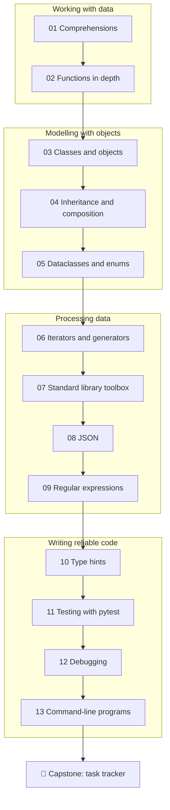

# 🔵 Intermediate level

**Goal:** after this level you can structure programs that are bigger than one screen. You model your
data with classes, dataclasses and enums, process it lazily with generators, lean on the standard
library instead of reinventing it, and prove that it works with your own pytest tests.

**Time:** about 35–45 hours, spread over a few weeks.

**You need:** the [Beginner level](../beginner/) (or equivalent knowledge: functions, lists, dicts,
exceptions, files, modules, venvs) and the setup from the [main README](../README.md#set-up-python-a-venv-and-pytest).

## The lessons

| # | Lesson | You will learn | Assignments |
|---|---|---|---|
| 01 | [Comprehensions](01-comprehensions/) | list, dict and set comprehensions, generator expressions, `zip`, `enumerate`, `any` / `all` | 01 |
| 02 | [Functions in depth](02-functions-in-depth/) | keyword-only arguments, unpacking, functions as values, closures, `nonlocal`, `functools.partial` | 02 |
| 03 | [Classes and objects](03-classes-and-objects/) | `class`, `self`, `__init__`, instance vs class attributes, `__repr__`, `__eq__`, `@property` | 03 |
| 04 | [Inheritance and composition](04-inheritance-and-composition/) | subclasses, `super()`, overriding, polymorphism, abstract base classes, "has-a" vs "is-a" | 04 |
| 05 | [Dataclasses and enums](05-dataclasses-and-enums/) | `@dataclass`, `field`, `frozen`, `Enum`, modelling data without boilerplate | 05 |
| 06 | [Iterators and generators](06-iterators-and-generators/) | the iterator protocol, `yield`, lazy pipelines, `itertools` building blocks | 06, 07 |
| 07 | [The standard library toolbox](07-standard-library-toolbox/) | `collections`, `itertools`, `functools`, `operator`, `datetime` in depth | 08 |
| 08 | [JSON and structured data](08-json-and-structured-data/) | `json`, serialising your own objects, validating data from the outside | 09 |
| 09 | [Regular expressions](09-regular-expressions/) | patterns, groups, `re.findall`, `re.sub`, when *not* to use a regex | 10 |
| 10 | [Type hints](10-type-hints/) | annotations, `list[int]`, `X \| None`, `TypedDict`, `Protocol`, checking with mypy | 11 |
| 11 | [Testing with pytest](11-testing-with-pytest/) | writing your own tests, fixtures, `parametrize`, `pytest.raises`, `tmp_path`, test design | 12 |
| 12 | [Debugging](12-debugging/) | a debugging method, `breakpoint()` and pdb, `assert`, `logging` basics | 13 |
| 13 | [Command-line programs](13-command-line-programs/) | `sys.argv`, `argparse`, exit codes, stdin/stdout, testable `main(argv)` | 14 |
| 🏁 | [Capstone: task tracker](capstone-task-tracker/) | everything above, in one tested command-line application | capstone |



## How each lesson is built

The same structure as in the Beginner level:

1. **What you will learn**: the goals, in one list.
2. **The theory**: how the feature works inside Python, with diagrams and short runnable examples.
   The output of each example is shown in a comment (`# → ...`).
3. **Common mistakes**: the errors almost everyone makes, and how to recognise them.
4. **Try it yourself**: a few quick REPL experiments.
5. **Summary**: the few lines worth remembering.
6. **Assignments**: the graded exercises for this lesson.

The assignments are bigger than in the Beginner level. Many of them ask you to write a class instead
of a few functions, and one of them asks you to write the tests yourself.

## How to check your work

From the repository root, with your venv active:

```bash
pytest intermediate/01-comprehensions/assignments/01-data-wrangler
```

Every task folder has the same three files: `README.md` (the task), `exercise.py` (your file) and
`test_exercise.py` (the tests). The template solutions are in [`solutions/intermediate/`](../solutions/intermediate/).
