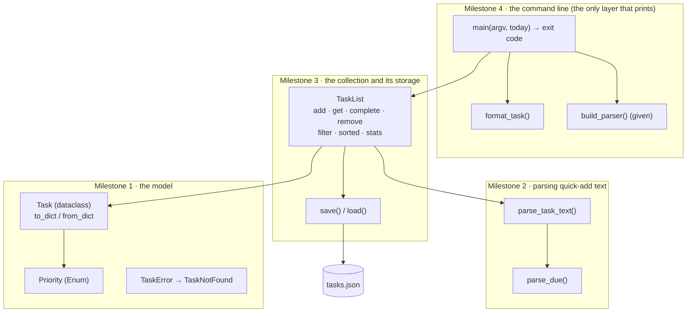

# 🏁 Capstone · Task tracker

> **Level:** 🔵 Intermediate · **Difficulty:** ⭐⭐⭐⭐⭐ · **Time:** ~6–8 h, spread over several sessions

You made it through all thirteen Intermediate lessons. Now build a real tool you can use every day: a
command-line task tracker with a quick-add syntax, due dates, priorities, tags, and a JSON file that keeps
your tasks between runs. It is built in four layers, and it uses **every** lesson of this level.

```text
$ python exercise.py add Buy milk due:fri '#home' '!high'
Added task 1: Buy milk
$ python exercise.py add Write report due:2026-10-01 '#work'
Added task 2: Write report
$ python exercise.py add Call Grace '#home'
Added task 3: Call Grace
$ python exercise.py done 3
Completed task 3: Call Grace
$ python exercise.py list --all
  2 [ ] Write report due:2026-10-01 #work (overdue)
  1 [ ] Buy milk !high due:2026-11-06 #home
  3 [x] Call Grace #home
$ python exercise.py stats
3 tasks: 1 done, 2 open, 1 overdue
open by tag: #home 1, #work 1
$ python exercise.py done 9
tasks: error: no task with id 9
```

(The quotes around `#home` and `!high` stop your shell from treating `#` as a comment and `!` as a history
command. In PowerShell, quote `#home` too.)

## How the program is built



Each layer only uses the layers below it. Nothing below Milestone 4 prints, reads `sys.argv` or calls
`date.today()`: "today" is always passed in as a parameter. That is what makes every layer easy to test,
and the tests use a fixed day, **Saturday 2026-10-31**.

## What you use from each lesson

| Lesson | Where it shows up |
|---|---|
| 01 Comprehensions · 07 Toolbox | sorting keys, `Counter` for tag statistics, building dicts and lists |
| 02 Functions in depth | keyword-only arguments in `filter(*, tag=None, done=None)`, injectable `today` |
| 03 Classes · 04 Inheritance | `TaskList` guards its rules; the exception hierarchy `TaskError` → `TaskNotFound` |
| 05 Dataclasses and enums | `Task`, `Stats`, `Priority` |
| 06 Iterators and generators | `TaskList.__iter__`, the lazy `filter()` generator |
| 08 JSON | `to_dict` / `from_dict`, validating the file, atomic saving |
| 09 Regular expressions | the quick-add markers `#tag`, `due:…`, `!priority` |
| 10 Type hints | the whole file is annotated (and passes `mypy --strict` in the template solution) |
| 11 Testing · 12 Debugging | 71 tests to guide you, `logging.debug` for load/save, `--verbose` |
| 13 Command-line programs | subcommands, stderr, exit codes, the testable `main(argv)` |

## Milestones

Work through them in order. Each has its own tests:

```bash
pytest intermediate/capstone-task-tracker -v -k milestone1
```

### Milestone 1 · The model

| Name | Specification |
|---|---|
| `Priority` | an `Enum`: `LOW = 1`, `NORMAL = 2`, `HIGH = 3` |
| `Task` | a dataclass with `id: int`, `title: str`, `priority = Priority.NORMAL`, `due: date \| None = None`, `tags: set[str]` (a new empty set by default), `done = False`. `__post_init__` strips the title (empty → `ValueError`) and lower-cases all tags |
| `Task.is_overdue(today)` | `True` if not done and `due` is before `today` |
| `Task.to_dict()` | `{"id": 7, "title": "...", "priority": "high", "due": "2026-11-06" or None, "tags": [sorted], "done": false}` |
| `Task.from_dict(data)` | the reverse. `priority`, `due`, `tags` and `done` are optional. **Any** problem (not a dict, missing or invalid fields) raises `TaskError` |

`TaskError` and `TaskNotFound` are given.

### Milestone 2 · Parsing quick-add text

`parse_task_text(text, today)` splits the text into `(title, priority, due, tags)`:

| Marker | Meaning | Example |
|---|---|---|
| `#word` | a tag (lower-cased); any number of them | `#home #Shop` → `{"home", "shop"}` |
| `due:VALUE` | the due date, at most once; `VALUE` is parsed by `parse_due` | `due:fri` |
| `!word` at the start of a word | the priority (`low`, `normal`, `high`), at most once | `!high` |
| everything else | the title, with runs of spaces squashed to one | |

The markers can appear anywhere. An empty title, an unknown priority, an invalid date or a duplicated
`due:` / `!priority` raise `ValueError`. An `!` **inside** a word is part of the title: `"Say hi!"`.

`parse_due(text, today)` understands (case-insensitively) `today`, `tomorrow`, weekday names in long or
short form (`friday`, `fri`: the **next** such day, 1 to 7 days ahead, so `sat` on a Saturday is a week
later) and ISO dates `YYYY-MM-DD`. Anything else: `ValueError("invalid due date: '<text>'")`.

```python
>>> parse_task_text("#Work !low Write   the report #urgent due:2026-11-20", date(2026, 10, 31))
('Write the report', <Priority.LOW: 1>, datetime.date(2026, 11, 20), {'work', 'urgent'})
```

### Milestone 3 · The task list and its storage

| Member | Specification |
|---|---|
| `TaskList(tasks=None)` | stores tasks by id; `len()` and iteration (in id order of insertion) work |
| `next_id()` | the highest id + 1, or 1 |
| `add(text, today)` | parses the text, creates the `Task` with `next_id()`, stores and returns it |
| `get(id)` / `complete(id)` / `remove(id)` | return the task (`complete` sets `done`, `remove` deletes it). Unknown id: `TaskNotFound("no task with id <id>")` |
| `filter(*, tag=None, done=None)` | a **generator** of the tasks matching every given criterion (`tag` is case-insensitive) |
| `sorted(tasks=None)` | a list of `tasks` (default: all) sorted: **open before done**, then by **due date** (earliest first, tasks without a due date last), then by **priority** (high first), then by **id** |
| `stats(today)` | a `Stats` (given): totals, and `tags`: the number of **open** tasks per tag, most first, ties alphabetically |
| `save(path)` | writes `{"version": 1, "tasks": [...]}` (tasks in id order) with `indent=2`, atomically |
| `TaskList.load(path)` | class method. A missing file gives an empty list. Invalid JSON, a wrong version, a wrong shape, an invalid task or **duplicate ids**: `TaskError` |

### Milestone 4 · The command line

`format_task(task, today)` builds one line of the list:

```text
  1 [ ] Buy milk !high due:2026-11-06 #home #shop
 12 [ ] Write report due:2026-10-01 (overdue)
  3 [x] Call Grace !low
```

The id is right-aligned in 3 characters, `[x]` marks done tasks; then the title, the priority (only if it is
not normal), the due date, the tags in alphabetical order, and `(overdue)` if the task is overdue.

`main(argv=None, today=None)` (with `today=None` meaning `date.today()`) parses the arguments with the given
`build_parser()`, **loads** the task file (`--file`, default `tasks.json` next to the script), runs the
command, **saves only if something changed**, prints the output and returns the exit code:

| Command | Prints |
|---|---|
| `add TEXT...` | `Added task <id>: <title>` |
| `list [--all] [--tag TAG]` | the open tasks (`--all`: all tasks) in `sorted` order, one `format_task` line each; `No tasks.` if there are none |
| `done ID` / `remove ID` | `Completed task <id>: <title>` / `Removed task <id>: <title>` |
| `stats` | `<total> tasks: <done> done, <open> open, <overdue> overdue`, plus `open by tag: #home 2, #work 1` if any open task has tags |

A `TaskError` or `ValueError` prints `tasks: error: <message>` to **stderr**, prints nothing to stdout, saves
nothing and returns `1`. Usage errors are handled by argparse (exit code 2). `--verbose` switches on
`logging` at DEBUG level, so you can see the log messages of `load` and `save`.

## Hints

<details>
<summary>Milestone 1: from_dict</summary>

Put the whole construction into one `try` block and catch `(KeyError, TypeError, ValueError)`: a missing key,
`int("x")`, `Priority["URGENT"]` (a `KeyError`!), `date.fromisoformat("soon")` and an empty title all end up
there. Re-raise as `TaskError(...) from None`.
</details>

<details>
<summary>Milestone 2: three small patterns</summary>

`#(\w+)` for tags, `\bdue:(\S+)` for the due date, and `(?<!\S)!(\w+)` for the priority: `(?<!\S)` is a
*lookbehind* meaning "not preceded by a non-space character", so the `!` must start a word. Use `findall`
to get all values (and check how many there are), then `sub` each pattern with a space and squash the
rest with `" ".join(rest.split())`. For the next weekday:
`today + timedelta(days=(target - today.weekday() - 1) % 7 + 1)`.
</details>

<details>
<summary>Milestone 3: one sort key</summary>

A tuple compares element by element, and `False < True`:
`(task.done, task.due is None, task.due or date.max, -task.priority.value, task.id)`.
</details>

<details>
<summary>Milestone 4: structure of main</summary>

Keep `main` short: parse, then one `try` around *load → run the command → save if changed*, and a single
`except (TaskError, ValueError)` that prints to stderr and returns 1. A helper `run(args, tasks, today)`
that returns `(output_lines, changed)` keeps the command logic out of `main`. Print only at the very end,
so a failing command never prints half its output.
</details>

## Try it for real

```bash
python intermediate/capstone-task-tracker/exercise.py add Finish the Intermediate level '!high' due:tomorrow
```

```bash
python intermediate/capstone-task-tracker/exercise.py list
```

Your tasks are stored in `intermediate/capstone-task-tracker/tasks.json`, which git ignores.

## Check your work

```bash
pytest intermediate/capstone-task-tracker -v
```

## Stretch goals

Done and all green? These have no tests; they are for practice.

- Run `mypy --strict` on your file and fix everything it reports.
- An `edit ID TEXT...` command that re-parses the text but keeps the id and the done state.
- Recurring tasks: `every:week` creates the next task when one is completed.
- A `--format json` option for `list`, so other programs can read your tasks.
- Write your own tests for a new feature **before** you implement it (lesson 11, TDD).
- Split the file into a package: `tasks/model.py`, `tasks/parsing.py`, `tasks/storage.py`, `tasks/cli.py`,
  plus `tasks/__main__.py` so `python -m tasks` works. The Advanced level starts from there.

## Done?

Compare with the [template solution](../../solutions/intermediate/capstone-task-tracker/exercise.py). Read it as
a whole: notice where validation happens, which layer is allowed to print, and how `today` travels from
`main` down to `is_overdue`.

Then tick off the capstone in the [progress checklist](../../README.md#progress-checklist).
**Congratulations: you have finished the Intermediate level. 🎉**

---

<p align="center">
  <a href="../13-command-line-programs/">← Previous: 13 · Command-line programs</a> · <a href="../README.md">Intermediate overview</a>
</p>
