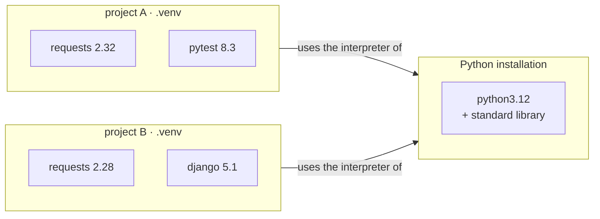
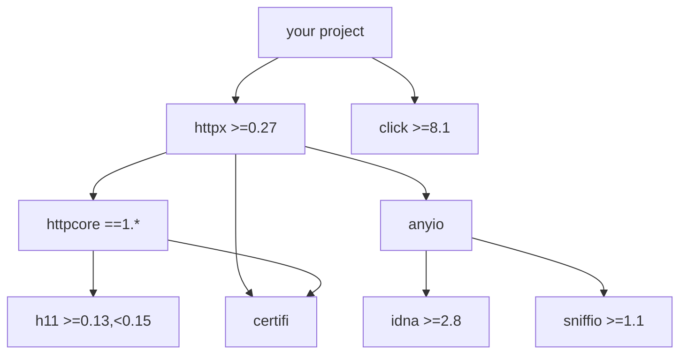
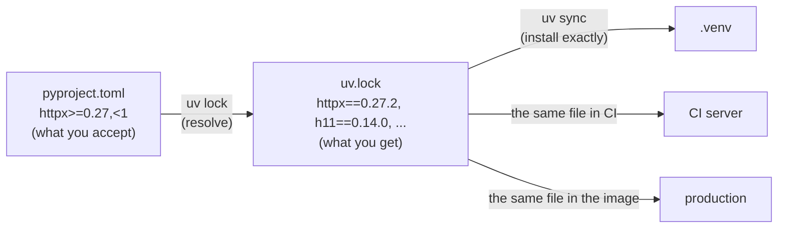

# Lesson 01 · Project setup

> **Level:** ⚫ Professional · **Time:** ~3 h · **Assignment:** [01 · Requirement checker](assignments/01-requirement-checker/)

A new colleague clones your repository. How long until they can run the tests? In a professional project
the answer is **minutes**, with commands written in the README, and the code behaves exactly as on your
machine and on the CI server. That does not happen by luck. It comes from a clear project layout,
isolated environments, and dependencies that are declared, constrained and locked. This lesson shows how
each piece works and how modern tools like `uv` put them together.

## What you will learn

- the files every Python project has, and what each one is for
- what a virtual environment really is, and why every project gets its own
- direct and transitive dependencies, and how a resolver picks versions
- version specifiers (`>=`, `<`, `~=`, `==`) and how versions are compared
- the difference between a library's ranges and an application's lock file
- a day-to-day workflow with `uv` (and the `pip` equivalents)

---

## 1. The anatomy of a project

```text
linkstats/
├── pyproject.toml        ← the project's identity card: metadata, dependencies, tool settings
├── uv.lock               ← exact versions of every package (generated, committed)
├── .python-version       ← which Python the project uses, e.g. 3.12
├── README.md             ← what it is, how to install, run and test it
├── LICENSE               ← who may use it, and how
├── .gitignore            ← .venv/, __pycache__/, dist/, .env, ...
├── src/
│   └── linkstats/        ← the package (lesson Advanced 12)
│       ├── __init__.py
│       └── ...
└── tests/
    └── test_*.py
```

Everything a tool needs to know lives in **one** file, `pyproject.toml`: the package metadata, its
dependencies, and the settings of pytest, mypy and ruff (`[tool.pytest.ini_options]`, `[tool.mypy]`,
`[tool.ruff]`). Fewer config files means fewer places for settings to disagree.

What does **not** go into the repository: the virtual environment, caches, build output, and secrets
(`.env` files with passwords, lesson 05). They belong in `.gitignore`.

## 2. Virtual environments, from the inside

A **virtual environment** (venv) is a folder with its own `site-packages`, so each project gets its own
set of installed packages. Two projects that need different versions of the same library no longer
fight over one global installation.

```text
$ python -m venv .venv
$ ls .venv
bin/   include/   lib/   pyvenv.cfg          (Windows: Scripts\ instead of bin/)
$ cat .venv/pyvenv.cfg
home = /usr/local/bin
include-system-site-packages = false
version = 3.12.4
```

It is not a copy of Python. `.venv/bin/python` is a link to the real interpreter. When Python starts, it
looks for a `pyvenv.cfg` next to (or one level above) the executable. If it finds one, it sets
`sys.prefix` to the venv folder, and `sys.path` gets the venv's `site-packages` instead of the global one:

```python
import sys
sys.prefix          # → '/home/ada/linkstats/.venv'         inside the venv
sys.base_prefix     # → '/usr/local'                        the real installation
sys.prefix != sys.base_prefix                               # → True: "am I in a venv?"
```

"Activating" (`source .venv/bin/activate`) only puts `.venv/bin` first on your `PATH`, so `python` and
`pip` mean the venv's. You can skip it and call `.venv/bin/python` directly; tools like `uv run` do
exactly that.



A venv is **disposable**: never edit files inside it, never commit it. If it breaks, delete it and
create it again from the declared dependencies. That only works if the dependencies **are** declared,
which brings us to the next section.

## 3. Dependencies and the resolver

The packages your code imports are your **direct** dependencies. They have dependencies of their own,
the **transitive** ones, and so on:



Two direct dependencies here pull in seven more packages. Every package states which versions of its
dependencies it accepts, and the **resolver** (inside `pip`, `uv` or Poetry) searches for one version of
each package that satisfies **all** constraints at once. If none exists, installing fails with a
conflict; it does not silently pick a version that breaks someone.

### Version specifiers

Python versions follow PEP 440: dot-separated numbers (`1.4.2`), optionally with pre-release or
post-release parts (`2.0rc1`, `1.0.post1`). Versions compare **number by number**, not as text:

| Comparison | Result | Why |
|---|---|---|
| `1.10` vs `1.9` | `1.10` is newer | 10 > 9, although the text "1.10" < "1.9" |
| `1.0` vs `1.0.0` | equal | missing parts count as 0 |
| `2.0rc1` vs `2.0` | `2.0` is newer | a release candidate comes before the release |

A **specifier** constrains the versions a dependency may have:

| Specifier | Means | Matches | Does not match |
|---|---|---|---|
| `>=1.4` | at least 1.4 | 1.4, 1.5, 3.0 | 1.3.9 |
| `<2` | below 2 | 1.99 | 2.0 |
| `>=1.4,<2` | both (comma = and) | 1.4, 1.9.3 | 2.0, 1.3 |
| `==1.4.2` | exactly | 1.4.2, 1.4.2.0 | 1.4.3 |
| `!=1.5.0` | anything but | 1.5.1 | 1.5.0 |
| `~=1.4.2` | "compatible release": `>=1.4.2, ==1.4.*` | 1.4.2, 1.4.9 | 1.5.0 |
| `~=1.4` | `>=1.4, ==1.*` | 1.4, 1.9 | 2.0 |

A full **requirement** line names the package and optionally extras and an environment marker:

```text
httpx[http2] >=0.27,<1 ; python_version >= "3.10"
└─┬─┘ └─┬─┘  └───┬────┘   └──────────┬──────────┘
 name  extras  specifiers      marker: only install when true
```

Package names are compared in a **normalised** form (PEP 503): lowercase, and every run of `-`, `_`
and `.` becomes one `-`. `Flask_SQLAlchemy`, `flask-sqlalchemy` and `flask.sqlalchemy` are the same
package.

## 4. Ranges for libraries, locks for applications

Two kinds of projects need two different things:

| | **Library** (installed into other projects) | **Application** (deployed and run) |
|---|---|---|
| examples | `httpx`, `wordtools`, your internal utils package | a web service, a CLI tool, a data pipeline |
| `dependencies` in `pyproject.toml` | **ranges**: `httpx>=0.27,<1` | ranges too |
| lock file | not used by people installing it | **committed**: exact version of every package |
| why | must fit together with the user's other libraries | must be reproducible: the same bytes in CI and in production |

A **lock file** records the result of resolving: every package, direct and transitive, with its exact
version (and usually a hash of the file, so a tampered download is rejected):

```text
# requirements.lock, the pip-tools / pip-freeze format
anyio==4.6.2
certifi==2024.8.30
h11==0.14.0
httpcore==1.0.6
httpx==0.27.2
idna==3.10
sniffio==1.3.1
```

The lock file is **generated**, never edited by hand, and **committed**, so everyone installs exactly
the same versions. Updating dependencies becomes a deliberate, reviewable change: re-lock, run the tests,
commit the new lock file.



## 5. A day with `uv`

`uv` is a fast, all-in-one tool that manages Python versions, venvs, dependencies and lock files. The
older tools still work and are good to know:

| Task | `uv` | Classic tools |
|---|---|---|
| start a project | `uv init linkstats` | write `pyproject.toml` by hand |
| install a Python version | `uv python install 3.12` | pyenv, the python.org installer |
| add a dependency | `uv add httpx` | edit `pyproject.toml`, `pip install httpx` |
| add a dev tool | `uv add --dev pytest ruff` | an optional `dev` extra |
| create the lock file | `uv lock` (automatic) | `pip-compile` (pip-tools) or `poetry lock` |
| create the venv and install the lock | `uv sync` | `python -m venv .venv` + `pip install -r requirements.lock` |
| run something in the venv | `uv run pytest` | activate, then `pytest` |
| update one package | `uv lock --upgrade-package httpx` | `pip-compile --upgrade-package httpx` |

`uv add --dev` puts tools that only developers need into a **dependency group**, so they are not
installed for users:

```toml
[project]
dependencies = ["httpx>=0.27,<1"]

[dependency-groups]
dev = ["pytest>=8", "ruff>=0.6", "mypy>=1.11"]
```

The README then says, in three lines, everything a new colleague needs:

```bash
uv sync               # creates .venv with the exact locked versions
uv run pytest         # all tests green?
uv run linkstats --help
```

---

## Common mistakes

**Installing into the global Python.** Sooner or later two projects need different versions. One venv
per project, always.

**Committing the venv.** Hundreds of megabytes, tied to one operating system and one path. Commit the
lock file instead and recreate the venv from it.

**An undeclared dependency.** It works on your machine because you once ran `pip install rich` by hand.
On the CI server it fails. Every import must be in `pyproject.toml`.

**Exact pins in a library** (`httpx==0.27.2`). Users cannot install it next to anything that needs
another version. Pin exactly only in the lock file of an application.

**No upper bound on a dependency that breaks often.** `pydantic>=1` happily installs pydantic 2, which
changed its API. For packages with a history of breaking releases, add `<next major`.

**Comparing versions as strings.** `"1.10" < "1.9"` is `True`. Use `packaging.version.Version` (or a
tuple of integers for simple cases).

## Try it yourself

1. Create a venv, print `sys.prefix` and `sys.base_prefix` inside and outside it.
2. Read `.venv/pyvenv.cfg`. Delete the venv and create it again: nothing is lost.
3. `pip install httpx` into a fresh venv, then `pip freeze`. How many packages do you see?
4. Install `uv` and run `uv init demo && cd demo && uv add httpx && uv run python -c "import httpx"`. Open `uv.lock`.
5. Which versions does `~=2.31` allow? Check your answer with `pip install "packaging"` and `SpecifierSet("~=2.31").contains("2.40")`.

## Summary

- A project is `pyproject.toml` (metadata, dependencies, tool settings) + `src/` + `tests/` + README, LICENSE, `.gitignore`.
- A venv is a folder with its own `site-packages`, found through `pyvenv.cfg`; it is disposable and never committed.
- The resolver picks one version per package that satisfies every constraint, including transitive ones.
- Versions compare number by number; specifiers `>=`, `<`, `==`, `!=`, `~=` combine with commas; names compare normalised.
- Libraries declare ranges; applications also commit a generated lock file with exact versions.
- `uv sync` + `uv run` make "clone, install, test" a matter of two commands.

## Assignment

➡️ **[01 · Requirement checker](assignments/01-requirement-checker/)**: parse versions and requirement lines, evaluate specifiers, and check a lock file against the declared dependencies, like a tiny resolver would.

---

<p align="center">
  <a href="../README.md">Professional overview</a> · <a href="../02-code-quality-tools/">Next: 02 · Code quality tools →</a>
</p>
