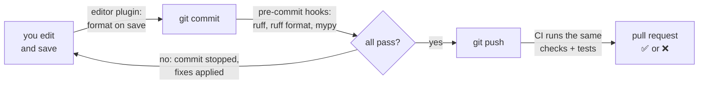
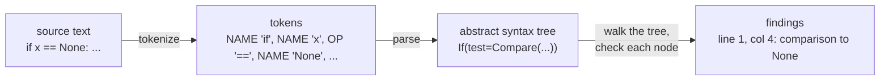
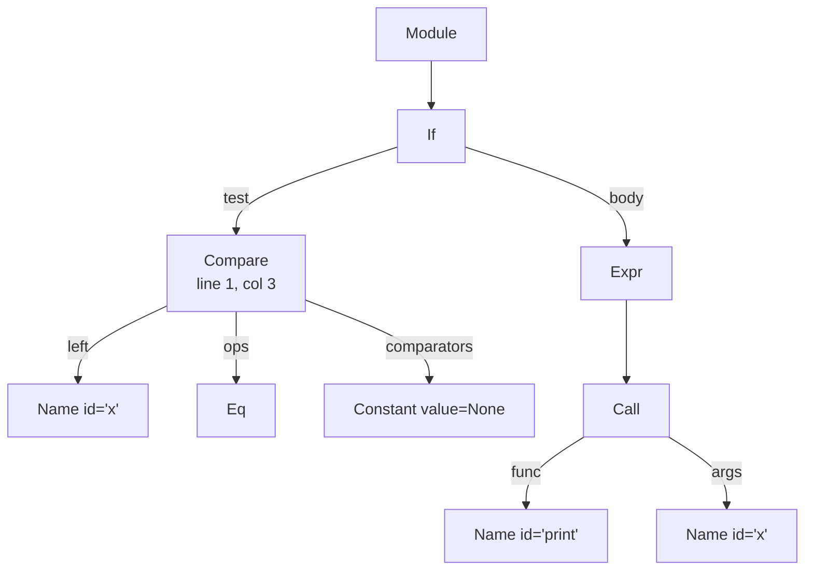

# Lesson 02 · Code quality tools

> **Level:** ⚫ Professional · **Time:** ~3 h · **Assignment:** [02 · Mini linter](assignments/02-mini-linter/)

In a team, nobody should spend review time on where a space goes or on an unused import. Machines do that
better, faster and without arguing. Professional projects run three kinds of tools on every change: a
**formatter** that makes all code look the same, a **linter** that finds likely bugs and bad patterns,
and a **type checker** that proves the types fit. This lesson shows what each one does, how to set them up
so they run automatically, and how a linter reads your code, so the warnings stop being magic.

## What you will learn

- formatter, linter and type checker: what each one catches
- `ruff` (lint and format), `mypy`, and how to configure them in `pyproject.toml`
- rule codes, `# noqa`, and when silencing a warning is right
- running everything automatically with `pre-commit` and in CI
- how a linter works: source → tokens → abstract syntax tree → checks
- walking an `ast` with `ast.NodeVisitor` and writing your own check

---

## 1. Three tools, three jobs

| | **Formatter** | **Linter** | **Type checker** |
|---|---|---|---|
| question | does it **look** the same everywhere? | is it **suspicious**? | do the **types** fit? |
| changes code? | yes, rewrites layout | reports (some fixes automatic) | reports only |
| example finding | `x=[1,2 ,3]` → `x = [1, 2, 3]` | `F401 'os' imported but unused` | `Argument 1 has incompatible type "str"; expected "int"` |
| tools | `ruff format`, `black` | `ruff check`, `flake8`, `pylint` | `mypy`, `pyright` |

They complement each other. The formatter ends style debates for good ("it is what the formatter
says"). The linter finds bugs that are syntactically fine: a mutable default argument, a bare `except:`
that swallows `KeyboardInterrupt`, a variable that is assigned and never used. The type checker (Advanced
lesson 07) finds calls that would fail at runtime.

## 2. ruff and mypy in practice

`ruff` is one fast tool that replaces flake8, isort, pyupgrade, black and dozens of plugins. Each check
has a **rule code**: a prefix for the family and a number.

```text
$ ruff check .
src/linkstats/report.py:3:8: F401 [*] `os` imported but unused
src/linkstats/report.py:14:5: E722 Do not use bare `except`
src/linkstats/store.py:22:31: B006 Do not use mutable data structures for argument defaults
Found 3 errors.
[*] 1 fixable with the `--fix` option.

$ ruff format .
2 files reformatted, 9 files left unchanged
```

| Prefix | Family | Example |
|---|---|---|
| `F` | Pyflakes: real errors | `F401` unused import, `F821` undefined name |
| `E`, `W` | pycodestyle: style | `E722` bare except |
| `I` | isort: import order | `I001` unsorted imports |
| `B` | flake8-bugbear: likely bugs | `B006` mutable default, `B008` call in default |
| `UP` | pyupgrade: modern syntax | `UP006` `List[int]` → `list[int]` |
| `S` | bandit: security (lesson 11) | `S608` SQL built from strings |

All settings live in `pyproject.toml`:

```toml
[tool.ruff]
line-length = 100
target-version = "py310"

[tool.ruff.lint]
select = ["E", "F", "W", "I", "B", "UP", "S"]
ignore = ["E501"]                          # line length: the formatter handles it

[tool.ruff.lint.per-file-ignores]
"tests/*" = ["S101"]                       # assert is fine in tests

[tool.mypy]
strict = true
packages = ["linkstats"]
```

### Silencing a finding

Sometimes the tool is wrong, or the code is deliberately unusual. Silence **one rule on one line**, and
say why:

```python
from .plugins import csv_export  # noqa: F401  (imported for its side effect: registers the plugin)
value = json.loads(text)  # type: ignore[no-any-return]
```

A bare `# noqa` silences **every** rule on the line, including the ones you did not mean. Prefer the code.

## 3. Running them automatically

A tool that people must remember to run is a tool that does not run. Two safety nets:



**pre-commit** runs checks on the files you are about to commit. Configure it once in
`.pre-commit-config.yaml`, then `pre-commit install` hooks it into Git:

```yaml
repos:
  - repo: https://github.com/astral-sh/ruff-pre-commit
    rev: v0.7.0
    hooks:
      - id: ruff
        args: [--fix]
      - id: ruff-format
  - repo: https://github.com/pre-commit/mirrors-mypy
    rev: v1.13.0
    hooks:
      - id: mypy
```

**CI** (lesson 12) runs the same commands on every push, because hooks can be skipped
(`git commit --no-verify`) and not everyone installs them. CI is the gate nobody can skip.

## 4. How a linter reads your code

A linter never runs your code. It **parses** it, exactly like Python does before executing:



The **abstract syntax tree** (AST) is your program as nested objects, one per piece of syntax. The
`ast` module gives you Python's own parser:

```python
import ast

tree = ast.parse("if x == None:\n    print(x)")
print(ast.dump(tree.body[0].test, indent=2))
# → Compare(
#     left=Name(id='x', ctx=Load()),
#     ops=[
#       Eq()],
#     comparators=[
#       Constant(value=None)])
```



Every node knows where it came from: `node.lineno` (1-based) and `node.col_offset` (0-based). Tools add
1 to the column when they print it.

### Visiting nodes

`ast.NodeVisitor` walks the whole tree and calls a method named after each node type: `visit_Call` for
every `Call`, `visit_Compare` for every `Compare`, and so on. Call `self.generic_visit(node)` to continue
into the node's children.

```python
class NoneComparison(ast.NodeVisitor):
    def __init__(self):
        self.findings = []

    def visit_Compare(self, node):
        for op, right in zip(node.ops, node.comparators):
            if isinstance(op, (ast.Eq, ast.NotEq)) and isinstance(right, ast.Constant) and right.value is None:
                self.findings.append((node.lineno, node.col_offset + 1, "use 'is None'"))
        self.generic_visit(node)               # keep walking: the operands may contain more comparisons

checker = NoneComparison()
checker.visit(ast.parse("if x == None:\n    pass"))
checker.findings                               # → [(1, 4, "use 'is None'")]
```

Some checks need **two passes** or a bit of memory. "Unused import" collects every imported name, then
every name that is used anywhere, and reports the difference. That is all a linter is: many small
visitors like this one, plus good messages.

`ast.walk(tree)` is the quick alternative when the order does not matter: it yields every node, so
`[n for n in ast.walk(tree) if isinstance(n, ast.Call)]` finds all calls.

---

## Common mistakes

**Arguing about style in reviews.** Pick a formatter, accept its output, move on.

**Turning on every rule at once in an old project.** Thousands of findings, so people ignore all of
them. Start with `F` and `E`, fix them, then add families one at a time.

**A bare `# noqa` or `# type: ignore`.** It hides the next real problem on that line too. Name the code.

**Checks only on your machine.** Hooks can be skipped. Run the same commands in CI.

**Different settings in different places.** `setup.cfg`, `.flake8`, `mypy.ini` and `pyproject.toml`
disagreeing about line length. Keep everything in `pyproject.toml`.

**Forgetting `generic_visit`** in a visitor. The walk stops at that node, and nested code is never checked.

## Try it yourself

1. `pip install ruff` and run `ruff check` and `ruff format --diff` on one of your old assignment solutions.
2. Add `select = ["B"]` and find the bugbear rules that fire.
3. Print `ast.dump(ast.parse("def f(a=[]): pass"), indent=2)`. Where is the default value?
4. Write a visitor that reports every function longer than 20 lines (`node.end_lineno - node.lineno`).
5. Install `pre-commit`, add the config from section 3 to a project, and make a commit with an unused import.

## Summary

- Formatter = same layout everywhere; linter = suspicious code; type checker = types that do not fit.
- `ruff check`, `ruff format` and `mypy`, configured in `pyproject.toml`, cover all three.
- Rule codes name each check; silence one code on one line with a reason, never a bare `# noqa`.
- pre-commit runs the tools before each commit; CI runs them on every push, and cannot be skipped.
- A linter parses source into an AST and walks it; `ast.parse`, `ast.dump`, `ast.NodeVisitor` and `ast.walk` are all you need to write a check.

## Assignment

➡️ **[02 · Mini linter](assignments/02-mini-linter/)**: a small linter with five rules, `# noqa` support, rule selection and a command line, built on `ast`.

---

<p align="center">
  <a href="../01-project-setup/">← Previous: 01 · Project setup</a> · <a href="../README.md">Professional overview</a> · <a href="../03-testing-like-a-professional/">Next: 03 · Testing like a professional →</a>
</p>
