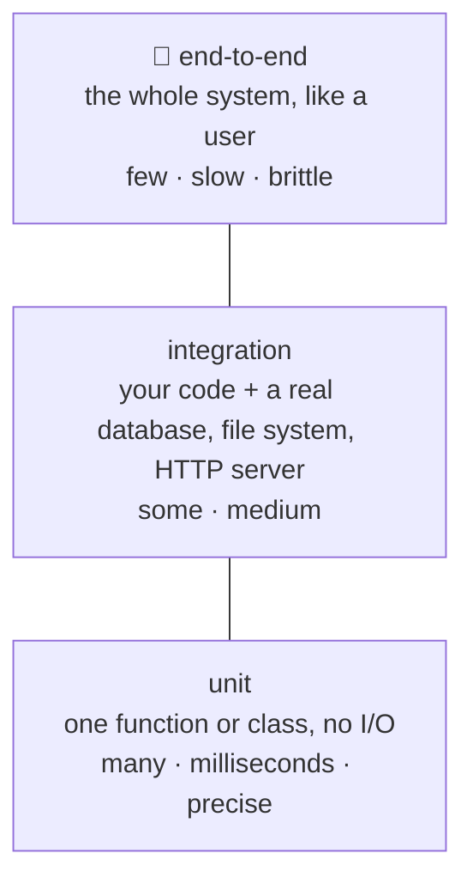
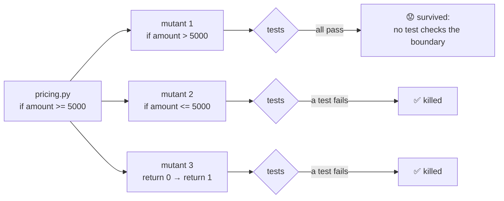

# Lesson 03 · Testing like a professional

> **Level:** ⚫ Professional · **Time:** ~3.5 h · **Assignment:** [03 · Test the tests](assignments/03-test-the-tests/)

You have written pytest tests since Intermediate lesson 11. In a professional codebase tests are more
than a check that the code runs: they are the **safety net** that lets a team change code every day
without fear. A good test suite is fast, never flaky, fails for exactly one reason, and catches the bugs
that matter. This lesson covers the tools and habits that get you there, and how to find out whether
your tests are actually good.

## What you will learn

- the test pyramid: unit, integration and end-to-end tests
- what a good test looks like: arrange, act, assert; one behaviour per test
- fixtures in depth: scopes, teardown with `yield`, `conftest.py`, factory fixtures
- parametrize with ids, markers, `skip` and `xfail`
- test doubles: stubs, fakes, spies and mocks, and `unittest.mock`
- coverage, and why 100 % coverage does not mean "well tested"
- mutation testing: testing your tests

---

## 1. The test pyramid



Most tests should be **unit tests**: they run in milliseconds and, when one fails, point at the bug.
**Integration tests** check that the pieces fit (your SQL really runs on SQLite, your client really
speaks HTTP). A few **end-to-end tests** prove the main user journeys work. Turn the pyramid upside down
and the suite becomes slow and flaky, so people stop running it.

## 2. Anatomy of a good test

```python
def test_discount_code_is_case_insensitive():
    cart = Cart([Item("book", 2000)])          # arrange: build the situation

    total = cart.total(code="save10")          # act: do exactly one thing

    assert total == 1800                       # assert: check the outcome
```

| Property | Means | Breaks when |
|---|---|---|
| **fast** | milliseconds | it sleeps, hits the network, starts processes |
| **isolated** | order does not matter; no shared state | tests write to the same global or file |
| **deterministic** | the same result every run | it uses the real clock, randomness, or a dict of threads |
| **one reason to fail** | one behaviour per test | a test checks ten things; the name says nothing |
| **behaviour, not implementation** | tests what the code does, not how | it asserts on private attributes; every refactoring breaks it |

The test **name** is documentation: `test_flat_discount_needs_minimum_order` tells you what broke
before you read a line of code.

## 3. Fixtures in depth

A fixture provides what a test needs, and cleans up after it. Code after `yield` is the teardown, and it
runs even if the test fails:

```python
import sqlite3
import pytest

@pytest.fixture
def db():
    connection = sqlite3.connect(":memory:")
    connection.execute("CREATE TABLE users (name TEXT)")
    yield connection                           # the test runs here
    connection.close()                         # teardown

def test_insert(db):
    db.execute("INSERT INTO users VALUES ('ada')")
    assert db.execute("SELECT count(*) FROM users").fetchone() == (1,)
```

| Feature | How | Use |
|---|---|---|
| scope | `@pytest.fixture(scope="module")` | share an expensive resource (`"function"` is the default; also `"class"`, `"package"`, `"session"`) |
| sharing | put fixtures in a `conftest.py` | every test in that folder and below can use them, without imports |
| fixtures using fixtures | `def user(db): ...` | build on each other; pytest resolves the order |
| factory fixture | return a function | when a test needs several, slightly different objects |
| built-ins | `tmp_path`, `monkeypatch`, `capsys`, `caplog` | a temp folder, safe patching, captured output and logs |

```python
@pytest.fixture
def make_item():
    def make(name="book", price=1000, quantity=1):
        return Item(name, price, quantity)
    return make

def test_subtotal(make_item):
    assert subtotal([make_item(price=500, quantity=3), make_item()]) == 2500
```

## 4. Parametrize and markers

One test function, many cases. `ids` make failures readable:

```python
@pytest.mark.parametrize(
    "amount, expected",
    [(4999, 495), (5000, 0), (12_000, 0)],
    ids=["just-below-free", "exactly-free", "far-above"],
)
def test_shipping(amount, expected):
    assert shipping(amount) == expected
```

```text
test_shop.py::test_shipping[just-below-free] PASSED
test_shop.py::test_shipping[exactly-free] FAILED
```

Pick cases at the **boundaries**: just below, exactly at, just above a limit. Most off-by-one bugs live
there. Markers tag tests: `@pytest.mark.skipif(sys.platform == "win32", reason=...)`,
`@pytest.mark.xfail(reason="bug #123")` for a known bug, and your own markers (`@pytest.mark.slow`,
registered in `pyproject.toml`) to run subsets with `pytest -m "not slow"`.

## 5. Test doubles

Code talks to things you do not want in a unit test: a payment service, the clock, an exchange-rate API.
You replace them with a **test double**. The names describe what the double does:

| Double | Does | Example |
|---|---|---|
| **dummy** | is passed, never used | `None` for a logger the test does not care about |
| **stub** | returns canned answers | `get_rate` always returns `1.1` |
| **fake** | a working, simpler implementation | a dict instead of a database |
| **spy** | records how it was called | a list that collects every message sent |
| **mock** | a spy that you check with assertions | `rates.get_rate.assert_called_once_with("USD")` |

The cleanest way to use a double is to **pass it in** (dependency injection, lesson 10): a function that
takes `rates` as a parameter can get a fake in tests and the real client in production.

### `unittest.mock`

`Mock` creates objects that accept any call and remember it:

```python
from unittest.mock import Mock

rates = Mock()
rates.get_rate.return_value = 1.1              # stub behaviour

convert(1000, "USD", rates)                    # → 1100

rates.get_rate.assert_called_once_with("USD")  # spy check: called once, with this argument
rates.get_rate.call_args_list                  # → [call('USD')]

rates.get_rate.side_effect = ConnectionError   # now every call raises
```

`side_effect` can also be a list (one result per call) or a function. `Mock(spec=RateClient)` only
allows methods the real class has, so a typo in the test fails instead of passing silently.

When the dependency is not passed in but imported, `patch` replaces it **where it is looked up**:

```python
from unittest.mock import patch

with patch("shop.pricing.fetch_rate", return_value=1.1):    # the name inside shop.pricing
    assert convert(1000, "USD") == 1100
```

pytest's `monkeypatch.setattr(pricing, "fetch_rate", lambda c: 1.1)` does the same and is undone
automatically after the test.

**Do not over-mock.** A test that mocks everything checks only that the code calls what it calls. Mock at
the **boundaries** (network, clock, randomness, slow services), and use real objects inside.

## 6. Coverage

Coverage measures which lines (and branches) your tests executed:

```text
$ pip install pytest-cov
$ pytest --cov=shop --cov-branch --cov-report=term-missing
Name               Stmts   Miss Branch BrPart  Cover   Missing
--------------------------------------------------------------
shop/pricing.py       24      2      8      1    91%   31-32
```

The `Missing` column shows lines no test ran: definitely untested. But the reverse does not hold. A line
that ran was not necessarily **checked**:

```python
def test_shipping_runs():
    shipping(4999)                 # 100 % coverage of shipping(), and no assert at all
```

Coverage finds gaps; it cannot prove quality. Use it as a flashlight, not as a target.

## 7. Mutation testing: testing your tests

To know whether your tests would **catch** a bug, plant one and see. A mutation testing tool (`mutmut`,
`cosmic-ray`) does this automatically: it changes your code in small ways and runs the tests on each
**mutant**.



A **surviving** mutant shows a missing test: here, nobody checks what happens at exactly 5000. Mutation
testing is slow, so teams run it now and then on important modules, not on every commit. The habit it
teaches is valuable on its own: for every test, ask **"which bug would make this fail?"**

---

## Common mistakes

**Tests that depend on each other.** Test B passes only after test A ran. The plugin `pytest-randomly`
shuffles the order on every run and finds them; give every test its own setup.

**Sleeping in tests.** `time.sleep(1)` to "wait for" something. Inject a clock or use an event.

**Mocking what you own, in detail.** The test copies the implementation line by line and breaks on every
refactoring. Mock at boundaries; test behaviour.

**Patching the wrong name.** `patch("requests.get")` does nothing if the module did `from requests import
get`. Patch where the name is **used**.

**Asserting too little.** `assert result` passes for any non-empty value. Assert the exact value.

**Chasing a coverage number.** Tests without asserts raise coverage and catch nothing.

## Try it yourself

1. Write a fixture with `yield` that prints `setup` and `teardown`. Run with `pytest -s`, once with a passing and once with a failing test.
2. Make a fixture `scope="module"` and print in it. How often does it run for three tests?
3. Create a `Mock()`, call `m.anything(1, x=2)`, and look at `m.method_calls` and `m.anything.call_args`.
4. `pip install pytest-cov`, run it with `--cov-branch` on one of your earlier assignments, and find a branch no test takes.
5. Change one `>=` to `>` in one of your solutions. Do your tests notice?

## Summary

- Many fast unit tests, some integration tests, few end-to-end tests.
- Good tests are fast, isolated, deterministic, test one behaviour, and are named after it.
- Fixtures provide and clean up (`yield`); share them in `conftest.py`; factory fixtures make variants.
- Parametrize at the boundaries; markers select, skip and document tests.
- Replace boundaries with stubs, fakes and mocks; `Mock`, `return_value`, `side_effect`, `assert_called_once_with`; patch where the name is used.
- Coverage shows what never ran; mutation testing shows what your tests would not catch.

## Assignment

➡️ **[03 · Test the tests](assignments/03-test-the-tests/)**: this time **you** write the tests. They must pass on a correct pricing module and catch ten planted bugs, including one that only a mock can see.

---

<p align="center">
  <a href="../02-code-quality-tools/">← Previous: 02 · Code quality tools</a> · <a href="../README.md">Professional overview</a> · <a href="../04-logging/">Next: 04 · Logging →</a>
</p>
