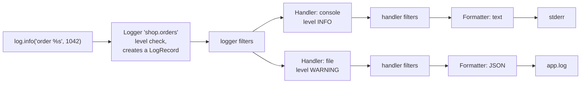
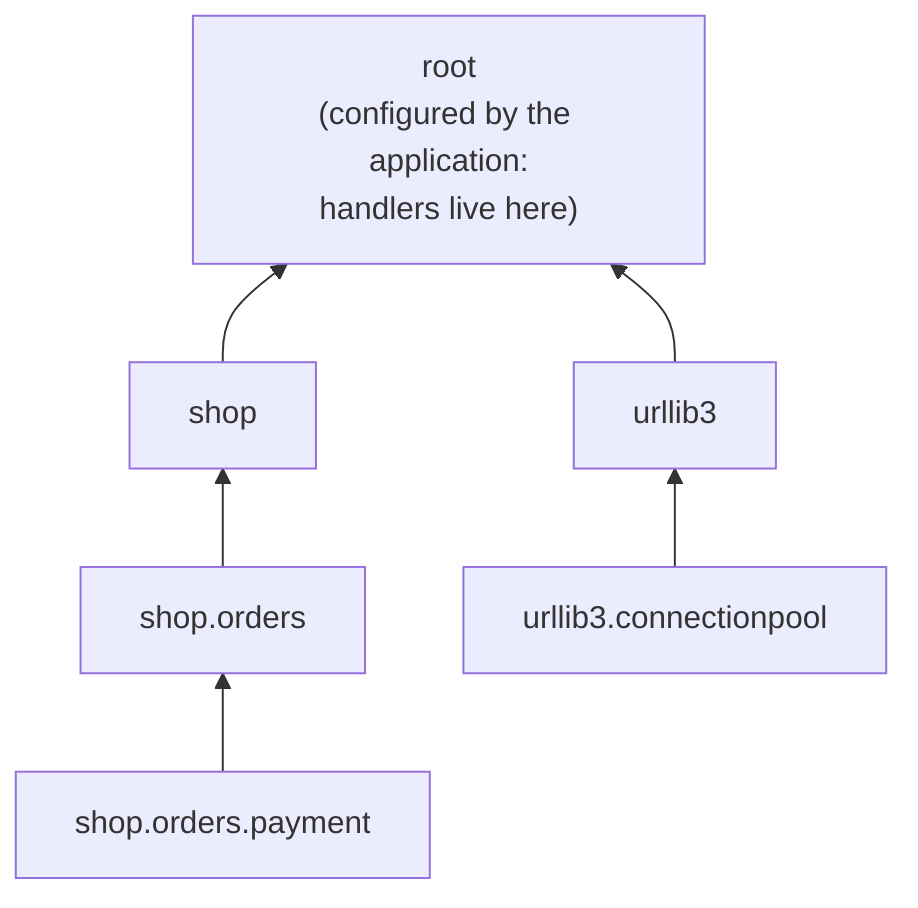

# Lesson 04 · Logging

> **Level:** ⚫ Professional · **Time:** ~3 h · **Assignment:** [04 · Logging setup](assignments/04-logging-setup/)

At 3 a.m. a customer's order fails on a server you cannot log into with a debugger. The only witness is
the **log**. Whether you find the cause in five minutes or never depends on decisions made when the code
was written: what was logged, at which level, with which context, and in which format. `print` cannot do
this job. The `logging` module can, once you understand its four building blocks.

## What you will learn

- why `print` is not logging, and what the log levels mean
- loggers, handlers, formatters and filters, and how a record flows through them
- the logger hierarchy, `getLogger(__name__)` and propagation
- configuring logging once, at the entry point, with `dictConfig`
- logging exceptions, extra fields and structured (JSON) logs
- adding a request id to every line with `contextvars`
- what never to log

---

## 1. Why not `print`?

| | `print` | `logging` |
|---|---|---|
| how important is it? | unknown | a **level**: `DEBUG` … `CRITICAL` |
| where does it come from? | unknown | logger name, file, line, time, thread |
| where does it go? | stdout | console, file, syslog, a log service, several at once |
| turn it off or down? | edit the code | change the configuration |
| in a library | forces output on every user | silent unless the application wants it |

```python
import logging

logging.basicConfig(level=logging.INFO, format="%(asctime)s %(levelname)-8s %(name)s: %(message)s")
log = logging.getLogger("shop.orders")

log.info("order %s placed by %s", 1042, "ada")
log.debug("cart contents: %r", cart)          # below INFO: not shown
# → 2026-11-01 00:12:00,493 INFO     shop.orders: order 1042 placed by ada
```

### Levels

| Level | Value | Use for | Example |
|---|---|---|---|
| `DEBUG` | 10 | details for developers while hunting a bug | `"cache miss for key %s"` |
| `INFO` | 20 | normal, noteworthy events | `"order 1042 placed"` |
| `WARNING` | 30 | something unexpected, but the program copes | `"rate API slow, using cached rates"` |
| `ERROR` | 40 | an operation failed | `"payment for order 1042 failed"` |
| `CRITICAL` | 50 | the program cannot continue | `"database unreachable, shutting down"` |

A logger with level `INFO` drops `DEBUG` records. Production usually runs at `INFO`; you switch to
`DEBUG` while investigating, **without changing code**.

## 2. The four building blocks



| Block | Job |
|---|---|
| **Logger** | what your code calls. Has a name and a level; creates a `LogRecord` (message, args, level, time, file, line, …) |
| **Handler** | sends records somewhere: `StreamHandler`, `FileHandler`, `RotatingFileHandler`, `SysLogHandler`, … Has its own level |
| **Formatter** | turns a record into text: `"%(asctime)s %(levelname)s %(message)s"` |
| **Filter** | decides whether a record passes, and may **change** it, for example add a field or hide a password |

Pass arguments separately (`log.info("order %s", order_id)`), not as an f-string. The message is only
formatted if a handler actually emits it, and log tools can group all records with the same template.

## 3. The logger hierarchy

Logger names are dotted paths, and they form a tree. A record is handled by its logger's handlers, then
**propagates** to the parent's handlers, up to the **root** logger:



The rule that follows from this:

- **Every module** creates its logger with `log = logging.getLogger(__name__)`. The name is then the
  module path (`shop.orders.payment`), so you see where each line came from, and you can tune whole
  packages: `logging.getLogger("urllib3").setLevel(logging.WARNING)`.
- **Libraries** never configure handlers. Their records propagate to whatever the application set up.
- **The application** configures logging **once**, at the entry point (`main()`), usually on the root
  logger.

## 4. Configuring with `dictConfig`

`basicConfig` is fine for scripts. Applications describe the whole setup as data, which can also come
from a file:

```python
import logging.config

logging.config.dictConfig({
    "version": 1,
    "disable_existing_loggers": False,          # keep loggers that modules created at import time
    "formatters": {
        "plain": {"format": "%(asctime)s %(levelname)-8s %(name)s: %(message)s"},
    },
    "handlers": {
        "console": {"class": "logging.StreamHandler", "formatter": "plain", "stream": "ext://sys.stderr"},
        "file": {"class": "logging.handlers.RotatingFileHandler", "filename": "app.log",
                 "maxBytes": 10_000_000, "backupCount": 5, "level": "WARNING", "formatter": "plain"},
    },
    "loggers": {
        "urllib3": {"level": "WARNING"},        # quieter third-party library
    },
    "root": {"level": "INFO", "handlers": ["console", "file"]},
})
```

Your own classes plug in with the special key `"()"`: `"formatters": {"json": {"()": JsonFormatter}}`
creates the formatter by calling `JsonFormatter()`; the same works for filters and handlers.

## 5. Exceptions and extra fields

`log.exception(...)` logs at `ERROR` and appends the traceback. Use it in an `except` block:

```python
try:
    charge(order)
except PaymentError:
    log.exception("payment failed for order %s", order.id)
    raise
# → 2026-11-01 00:12:00,493 ERROR    shop.orders: payment failed for order 1042
#   Traceback (most recent call last):
#     ...
```

Any level accepts `exc_info=True` to do the same. Log an exception **or** re-raise it, and handle it in
one place: logging it at every level of the call stack fills the log with five copies of one error.

`extra` adds fields to the record; a formatter can show them:

```python
log.info("order placed", extra={"order_id": 1042, "amount_cents": 2495})
```

## 6. Structured logs

A text line is for humans. Log **services** (Elasticsearch, Loki, Datadog, CloudWatch) work much better
with **one JSON object per line**: every field can be searched, filtered and counted ("all errors for
order 1042", "average `duration_ms` per endpoint").

```text
{"time": "2026-11-01T00:12:00.493+00:00", "level": "INFO", "logger": "shop.orders", "message": "order placed", "order_id": 1042, "amount_cents": 2495, "request_id": "7f3a"}
```

You get there with a custom `Formatter` whose `format(record)` builds a dict and returns
`json.dumps(...)`. Libraries like `structlog` and `python-json-logger` do the same with more features.

## 7. Context: which request was it?

A web server handles many requests at once, and their log lines interleave. A **request id** in every
line lets you pull out everything that happened for one request. Passing it into every function by hand
is not practical. A `contextvars.ContextVar` holds a value for the current **context** (thread or asyncio
task), and a filter copies it into every record:

```python
import contextvars

request_id = contextvars.ContextVar("request_id", default="-")

class RequestIdFilter(logging.Filter):
    def filter(self, record):
        record.request_id = request_id.get()
        return True                              # keep the record; we only added a field

token = request_id.set("7f3a")                   # at the start of a request
...                                              # every log line now carries request_id=7f3a
request_id.reset(token)                          # at the end
```

Attach the filter to the **handler**, so it also sees records that propagate from other loggers.

## 8. What never to log

Logs are copied, shipped, kept for months and read by many people. Never log:

- passwords, API keys, tokens, session cookies, private keys (lesson 11);
- full credit card numbers or other payment data;
- personal data you do not need (in the EU the GDPR applies to logs too).

A **redacting filter** is a safety net that masks known secret fields before they reach any handler. It
does not replace the habit of not logging them in the first place.

---

## Common mistakes

**`print` for diagnostics in an application.** No level, no context, no way to turn it off.

**Configuring logging in a library** (`basicConfig` at import time). It hijacks the application's setup.

**f-strings in log calls.** `log.debug(f"{expensive()}")` computes the string even when debug is off.
Use `log.debug("%s", value)`.

**`log.error(e)` instead of `log.exception(...)`.** You get the message and lose the traceback.

**Logging and re-raising at every level.** One error, five tracebacks. Log where you handle it.

**`disable_existing_loggers` left at `True`** (the default in `dictConfig`). Loggers created at import
time, before the configuration, go silent.

**Secrets in logs.** Once shipped to a log service, you cannot take them back. Rotate the secret.

## Try it yourself

1. Log the same message with `print` and with `logging.basicConfig(format=...)` including `%(filename)s:%(lineno)d`.
2. Create loggers `a`, `a.b` and `a.b.c`, add a handler only to `a`, and log from `a.b.c`. Then set `propagate = False` on `a.b`.
3. Configure two handlers with different levels, one to the console and one to a file.
4. Write a `Formatter` subclass that puts the level in brackets: `[INFO] message`.
5. Set a `ContextVar` in two threads to different values and log from both with the filter above.

## Summary

- Use `logging`, not `print`: levels, sources, destinations and configuration without code changes.
- Logger (name, level) → filters → handlers (destination, level) → formatter (text).
- `getLogger(__name__)` in every module; records propagate up to root; libraries never configure.
- Configure once at the entry point, with `dictConfig`; `"()"` plugs in your own classes.
- `log.exception` for errors with traceback; `extra` for fields; JSON lines for log services.
- A `ContextVar` + filter puts a request id on every line; never log secrets.

## Assignment

➡️ **[04 · Logging setup](assignments/04-logging-setup/)**: a JSON formatter, a redacting filter, request ids with `contextvars`, a `dictConfig` setup and a timing context manager.

---

<p align="center">
  <a href="../03-testing-like-a-professional/">← Previous: 03 · Testing like a professional</a> · <a href="../README.md">Professional overview</a> · <a href="../05-configuration-and-secrets/">Next: 05 · Configuration and secrets →</a>
</p>
