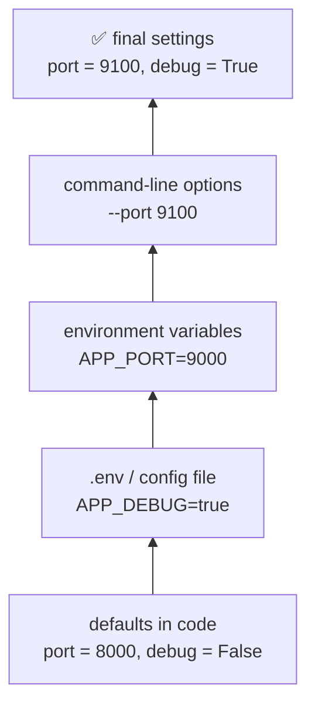
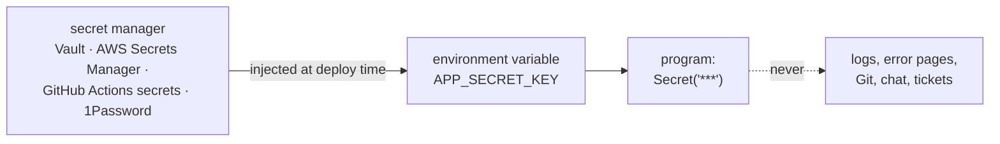

# Lesson 05 · Configuration and secrets

> **Level:** ⚫ Professional · **Time:** ~2.5 h · **Assignment:** [05 · Settings loader](assignments/05-settings-loader/)

The same code runs on your laptop, in CI, on a staging server and in production. What differs is the
**configuration**: which database, which port, debug on or off, which API key. If those values live in
the code, every deployment needs a code change, and sooner or later a production password ends up in Git.
This lesson shows how professionals separate configuration from code, load it in layers, validate it
once at startup, and keep secrets secret.

## What you will learn

- what counts as configuration, and the twelve-factor rule: config in the environment
- environment variables from Python, and why everything arrives as a string
- `.env` files for local development, config files (TOML, INI, JSON)
- layered settings: defaults, files, environment, command-line overrides
- validating all settings at startup and failing fast with a clear message
- secrets: never in Git, hidden in logs, stored in a secret manager, rotated when leaked

---

## 1. What is configuration?

**Configuration** is everything that changes between deployments, while the code stays the same:

| Configuration | Not configuration (belongs in code) |
|---|---|
| database URL, host names, ports | the SQL queries |
| API keys, passwords, signing keys | which API endpoints the client calls |
| debug flag, log level | the log format of your JSON formatter |
| feature flags, limits (`MAX_UPLOAD_MB`) | business rules that every deployment shares |

The **twelve-factor app** guideline puts it simply: store configuration in **environment variables**.
They are supported by every operating system, every container platform and every CI system, they are
never accidentally committed, and they can differ per deployment without touching a file.

## 2. Environment variables

```python
import os

os.environ["HOME"]                        # → '/home/ada'     KeyError if missing
os.environ.get("APP_PORT")                # → None            if missing
os.environ.get("APP_PORT", "8000")        # → '8000'          a default
```

```text
$ APP_PORT=9000 APP_DEBUG=true python app.py          # set for one command (macOS, Linux)
$ export APP_PORT=9000                                # for the rest of this shell session
PS> $env:APP_PORT = "9000"                            # Windows PowerShell
```

Everything in the environment is a **string**. `"false"` is a non-empty string, so it is truthy:

```python
debug = bool(os.environ.get("APP_DEBUG"))     # ❌ "false" → True
debug = os.environ.get("APP_DEBUG", "").lower() in {"1", "true", "yes", "on"}   # ✅
port = int(os.environ.get("APP_PORT", "8000"))                                    # ✅ may raise ValueError
```

Use a **prefix** (`APP_`, `LINKSTATS_`) for your variables, so they do not collide with other programs'
(`PORT`, `DEBUG` and `HOST` are used by many tools).

## 3. `.env` files and config files

Typing ten variables before every run is tedious. In development, a **`.env` file** in the project folder
holds them, and the program (or a tool like `python-dotenv`, `uv run --env-file`, Docker Compose) reads it:

```text
# .env (never committed: listed in .gitignore)
APP_DATABASE_URL=sqlite:///dev.db
APP_DEBUG=true
APP_SECRET_KEY="dev-only-not-secret"
export APP_ALLOWED_HOSTS=localhost,127.0.0.1
```

Commit a **`.env.example`** instead: the same keys with placeholder values, so a new colleague knows what
to set.

Settings that are not secret and rarely change can also live in a **config file**:

| Format | Read with | Good for |
|---|---|---|
| TOML | `tomllib` (3.11+, read-only) | the standard in Python (`pyproject.toml`) |
| INI | `configparser` | simple sections of key/value pairs |
| JSON | `json` | generated config, no comments allowed |
| YAML | `PyYAML` (third-party) | Kubernetes, CI files; use `yaml.safe_load` |

## 4. Layers

Real programs combine sources. Each layer **overrides** the one below:



The more specific and the more temporary a source, the higher it ranks: an option typed for one run
beats an environment variable set for the server, which beats a file shared by the team, which beats the
defaults in code.

## 5. Validate once, at startup

Read and convert all settings **in one place**, into one typed object, when the program starts:

```python
@dataclass(frozen=True)
class Settings:
    database_url: str
    port: int = 8000
    debug: bool = False

settings = load_settings()        # fails NOW if anything is wrong, with every problem listed
app = create_app(settings)        # the rest of the code receives a typed, validated object
```

**Fail fast.** A typo in `APP_PORT=80OO` should stop the program at startup with
`APP_PORT: expected an integer, got '80OO'`, not crash an hour later in the middle of a request. And
report **all** problems at once: fixing one error per deployment attempt is slow. Unknown variables with
your prefix (`APP_DEUBG`) are worth reporting too: they are almost always typos.

The `pydantic-settings` package does all of this from type hints. In the assignment you build the core of
it yourself.

## 6. Secrets

A **secret** is a value that gives access: passwords, API keys, tokens, signing keys, private keys.



| Rule | Why |
|---|---|
| **never commit a secret**, not even "for a moment" | Git keeps history forever; public repos are scanned by bots within minutes |
| `.env` in `.gitignore`, `.env.example` committed | the file layout is shared, the values are not |
| separate secrets per environment | a leaked development key must not open production |
| hide secrets in `repr`, logs and error messages | tracebacks and debug logs get copied around |
| use a **secret manager** in production | access control, audit log, rotation |
| **rotate** after a leak | deleting the commit does not help: the old value is already copied |

A tiny wrapper class keeps a secret out of `print`, logs and tracebacks:

```python
class Secret:
    def __init__(self, value):
        self._value = value
    def __repr__(self):
        return "Secret('***')"
    def reveal(self):
        return self._value                     # explicit: you see in the code where the secret is used

key = Secret("s3cr3t")
print(key)                                     # → Secret('***')
f"{key!r}"                                     # → "Secret('***')"
key.reveal()                                   # → 's3cr3t'
```

Tools like **gitleaks**, **trufflehog** and GitHub's secret scanning search files and the full Git history
for keys. Run one before making a repository public.

---

## Common mistakes

**`bool(os.environ["APP_DEBUG"])`.** Every non-empty string is truthy, including `"false"` and `"0"`.

**Settings read all over the code.** `os.environ.get(...)` in twenty modules: no validation, no overview,
hard to test. Read once, pass the settings object around.

**Crashing late.** A missing variable is only noticed when the first request needs it. Validate at startup.

**Committing `.env`.** Add it to `.gitignore` before the first commit; commit `.env.example`.

**"I deleted the commit, so the key is safe."** It is not. Revoke and rotate it.

**Secrets in the URL** (`?api_key=...`). URLs end up in server logs, browser history and proxies. Use a
header.

## Try it yourself

1. Run `python -c "import os; print(os.environ.get('APP_X'))"` once with and once without `APP_X=1` in front.
2. Print `bool("false")`, `bool("0")` and `bool("")`.
3. Write a `.env` file and load it with `pip install python-dotenv` and `dotenv.dotenv_values(".env")`.
4. Add a `Secret` to a dataclass and print the dataclass. Then raise an exception that contains it.
5. Search one of your repositories' history for a word like `password`: `git log -p | grep -i password`.

## Summary

- Configuration is what differs between deployments; keep it out of the code, mostly in environment variables with a prefix.
- Environment values are strings: convert booleans and numbers explicitly.
- `.env` for local development (ignored), `.env.example` committed; TOML/INI/JSON for non-secret files.
- Layers: defaults < file < environment < command line.
- Load everything once at startup into a typed, frozen object; report all problems at once; flag unknown keys.
- Secrets never go into Git or logs; wrap them, store them in a secret manager, rotate them after a leak.

## Assignment

➡️ **[05 · Settings loader](assignments/05-settings-loader/)**: a `.env` parser, a `Secret` type, and a layered, validating settings loader that reports every problem at once.

---

<p align="center">
  <a href="../04-logging/">← Previous: 04 · Logging</a> · <a href="../README.md">Professional overview</a> · <a href="../06-errors-and-resilience/">Next: 06 · Errors and resilience →</a>
</p>
