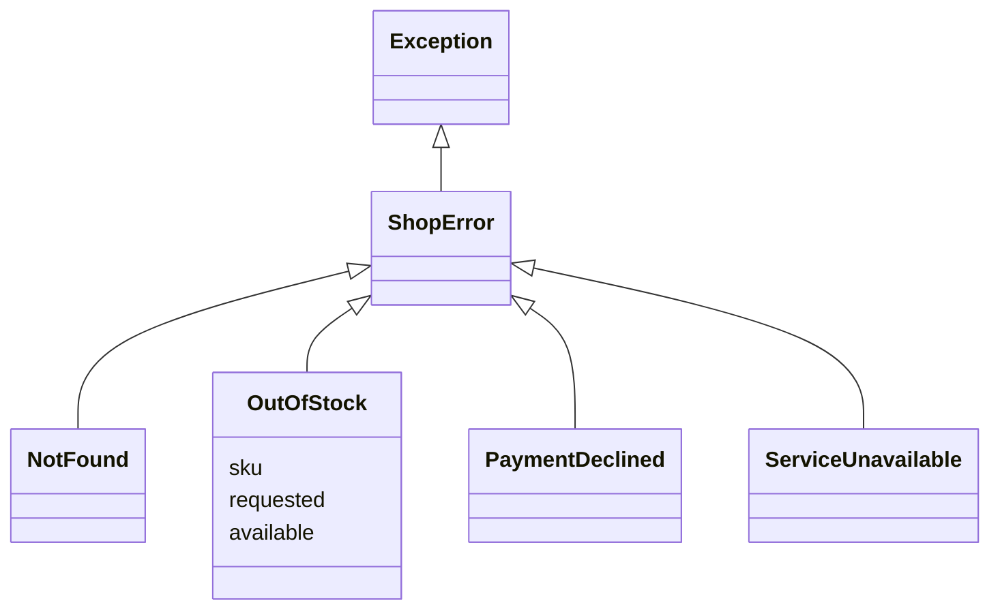
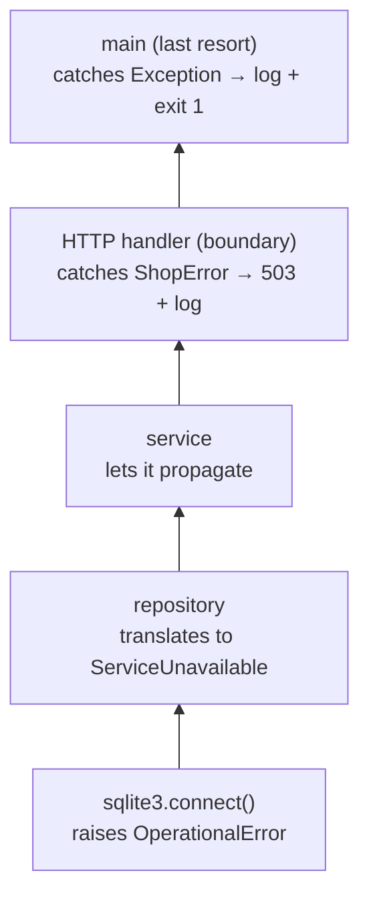
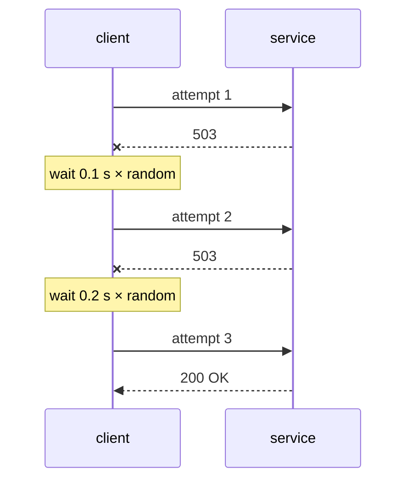
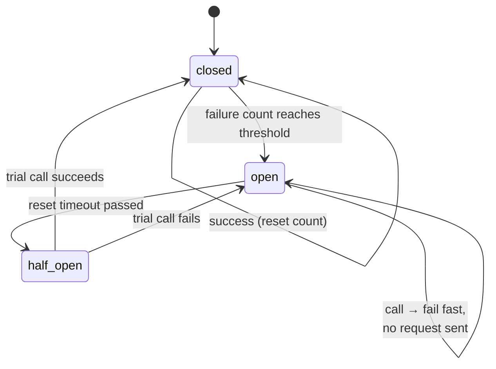

# Lesson 06 · Errors and resilience

> **Level:** ⚫ Professional · **Time:** ~3 h · **Assignment:** [06 · Resilience kit](assignments/06-resilience-kit/)

In production, things fail all the time: a network packet is lost, a database restarts, an API answers
with "too many requests", a disk fills up. Code that only works when everything works is not finished.
Professional code **expects** failure. It distinguishes errors that will go away from errors that will
not, retries the first kind carefully, gives up cleanly on the second, and stops hammering a service that
is already down. This lesson covers how to design exceptions for an application and the patterns that
make it resilient.

## What you will learn

- designing an exception hierarchy for your application
- where to catch: at the boundaries, not everywhere
- exception chaining with `raise ... from ...`
- transient and permanent errors
- retries with exponential backoff and jitter
- timeouts, circuit breakers, fallbacks and idempotency

---

## 1. An exception hierarchy for your application

Built-in exceptions describe **technical** problems (`KeyError`, `ConnectionError`). Your callers care
about **what went wrong for them**. Give your package one base exception and a few meaningful subclasses:

```python
class ShopError(Exception):
    """Base class: `except ShopError` catches everything this package raises on purpose."""

class NotFound(ShopError):
    pass

class OutOfStock(ShopError):
    def __init__(self, sku, requested, available):
        super().__init__(f"{sku}: requested {requested}, only {available} left")
        self.sku, self.requested, self.available = sku, requested, available

class PaymentDeclined(ShopError):
    pass
```



- One **base class** lets callers catch "anything from this library" without catching real bugs
  (`TypeError`, `AttributeError`).
- **Attributes** carry data, so the caller can react without parsing the message.
- Keep it small. A class is worth adding when some caller wants to catch **exactly** that case.

## 2. Where to catch

Catch an exception where you can **do something useful** with it: retry, use a fallback, show a message,
return an HTTP status. Everywhere else, let it fly.



There are typically two catching points: where a **low-level** error is **translated** into your own
(lesson 07: a database error becomes `ServiceUnavailable`), and the **boundary** where errors become a
response, an exit code, or a log line.

**Never swallow silently.** `except Exception: pass` turns a bug into a mystery. If you must ignore an
error, catch the narrowest type and log it.

## 3. Chaining: `raise ... from ...`

When you translate an error, keep the original. `raise New(...) from original` stores it in
`__cause__`, and the traceback shows both:

```python
def load(text):
    try:
        return json.loads(text)
    except json.JSONDecodeError as error:
        raise ConfigError("settings.json is not valid JSON") from error
```

```text
json.decoder.JSONDecodeError: Expecting property name enclosed in double quotes: line 1 column 2 (char 1)

The above exception was the direct cause of the following exception:

Traceback (most recent call last):
  ...
ConfigError: settings.json is not valid JSON
```

| Form | Traceback says | Use |
|---|---|---|
| `raise New() from error` | "was the direct cause of" | translating: the default choice |
| `raise New()` inside `except` | "During handling of the above exception, another exception occurred" | usually a bug in the handler |
| `raise New() from None` | only the new exception | the original adds nothing (e.g. a `KeyError` behind "unknown user") |

> Python 3.11+ adds `error.add_note("while loading user 42")` to attach context without a new exception,
> and `ExceptionGroup` with `except*` to raise several errors at once (as `asyncio.TaskGroup` does).

## 4. Transient and permanent errors

| | **Transient** (may go away) | **Permanent** (will not go away) |
|---|---|---|
| examples | timeout, connection reset, HTTP 429, 502, 503, 504, database is locked | HTTP 400, 401, 403, 404, 422, validation error, a bug |
| retry? | **yes**, with backoff | **no**: the result will be the same, only later |

Retrying a permanent error wastes time and hides the real problem. Retrying a transient error without a
pause makes it worse: if a service is overloaded, a thousand clients retrying immediately keep it
overloaded.

## 5. Retries with exponential backoff and jitter

Wait longer after each failed attempt: **exponential backoff** (`base × factor^attempt`, capped at a
maximum). Add **jitter**, a random part, so clients that failed at the same moment do not all retry at
the same moment too.



| Attempt that failed | Backoff (base 0.1, factor 2, max 5) | With full jitter |
|---|---|---|
| 1 | 0.1 s | random between 0 and 0.1 s |
| 2 | 0.2 s | between 0 and 0.2 s |
| 3 | 0.4 s | between 0 and 0.4 s |
| 7 | 6.4 s → **5 s** (cap) | between 0 and 5 s |

Rules of thumb: limit the **number of attempts** (3–5), cap the delay, retry only **transient** errors,
and respect a server's `Retry-After` header when it sends one. The `tenacity` library offers all of this
as a decorator. In the assignment you build it with an injected `sleep` and random generator, so the
tests run in milliseconds and are deterministic.

## 6. Timeouts

A call without a timeout can wait **forever**, and every waiting call holds a thread, a connection, a
user. Every network call gets one:

```python
urllib.request.urlopen(url, timeout=5)          # seconds
requests.get(url, timeout=(3, 10))              # connect timeout, read timeout
sqlite3.connect("app.db", timeout=5)            # waiting for a lock
```

Choose timeouts from what the caller can afford, not from what the callee usually needs.

## 7. Circuit breakers

When a service is down, retries from every request keep hitting it, and every request waits for its
timeout. A **circuit breaker** remembers recent failures and, after too many, **fails immediately**
without calling, giving the service time to recover. After a pause it lets **one** trial call through.



Fail fast is a **feature**: the user gets an error in a millisecond instead of after a 30-second timeout,
and the struggling service gets breathing room.

## 8. Fallbacks and idempotency

A **fallback** keeps the program useful when a dependency fails: cached exchange rates from an hour ago,
a default recommendation list, a "try again later" page instead of a crash.

Retries have a catch: if a request **did** reach the server but the answer was lost, the retry repeats
it. For reading, that is harmless. For "charge 50 €" it is not. An operation is **idempotent** when
doing it twice has the same effect as doing it once:

| Idempotent | Not idempotent |
|---|---|
| `GET`, `PUT` (set to a value), `DELETE` | `POST` "create order", "add 50 € to balance" |
| `UPDATE users SET email = ? WHERE id = ?` | `UPDATE accounts SET balance = balance + 50` |

Make dangerous operations idempotent with an **idempotency key**: the client sends a unique id with the
request, the server stores the result per key, and a repeated request with the same key returns the
stored result instead of charging again. Payment APIs like Stripe work exactly like this.

---

## Common mistakes

**`except Exception: pass`.** Bugs disappear without a trace. Catch narrowly, log, or let it propagate.

**Catching too early.** A function deep inside catches an error it cannot handle and returns `None`, and
the crash happens three calls later, far from the cause.

**Retrying everything.** A 404 or a validation error will not change. Retry only transient errors.

**Retrying without backoff and jitter.** Thousands of clients retrying in lockstep keep a service down.

**No timeout.** One slow dependency blocks every worker of your service.

**Retrying non-idempotent operations.** The customer is charged twice. Use idempotency keys.

**`raise New()` without `from`** inside `except`. The traceback says the handler itself failed. Use `from error`.

## Try it yourself

1. Run the `load("{oops")` example once with `from error`, once with `from None`, once without `from`. Compare the tracebacks.
2. Print `error.__cause__` and `error.__context__` for each of the three versions.
3. Write a loop that prints the backoff delays for 8 attempts with base 0.1, factor 2 and a cap of 2 seconds.
4. Add full jitter with `random.Random(42).uniform(0, delay)`, and run it twice. Same numbers? Why?
5. Sketch the circuit breaker on paper: what happens with threshold 3 and the results ✅ ❌ ❌ ✅ ❌ ❌ ❌?

## Summary

- One base exception per package, a few subclasses that callers want to catch, data in attributes.
- Catch where you can act: translate low-level errors once, handle at the boundary; never swallow silently.
- `raise New(...) from error` keeps the cause; `from None` hides an irrelevant one.
- Retry only transient errors, with a limited number of attempts, exponential backoff, a cap and jitter.
- Every network call has a timeout; a circuit breaker fails fast while a dependency is down.
- Fallbacks keep the program useful; idempotency keys make retries safe for operations with side effects.

## Assignment

➡️ **[06 · Resilience kit](assignments/06-resilience-kit/)**: backoff with jitter, a retry helper with an injected clock, a circuit breaker, error translation with chaining, and an idempotency guard.

---

<p align="center">
  <a href="../05-configuration-and-secrets/">← Previous: 05 · Configuration and secrets</a> · <a href="../README.md">Professional overview</a> · <a href="../07-databases/">Next: 07 · Databases →</a>
</p>
