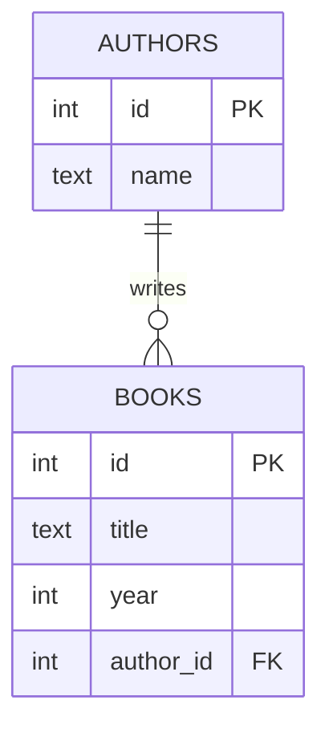
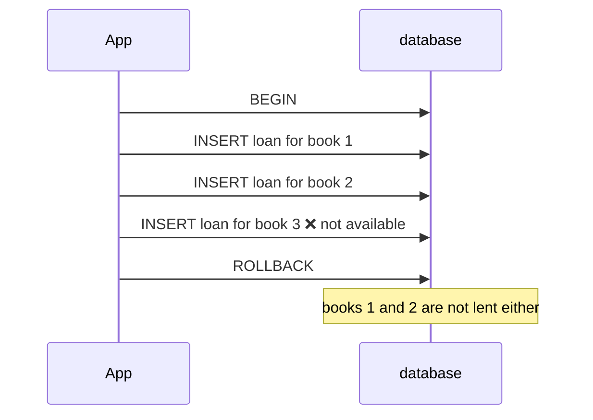
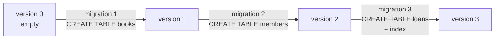
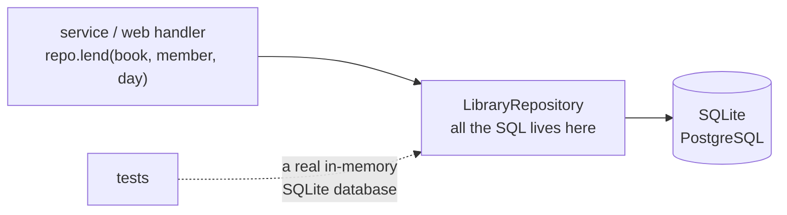

# Lesson 07 · Databases

> **Level:** ⚫ Professional · **Time:** ~3.5 h · **Assignment:** [07 · Library repository](assignments/07-library-repository/)

JSON files work until two processes write at the same time, the file grows to a gigabyte, or you need
"all loans of members who joined last year". Then you need a **database**: it stores data safely, lets
many users read and write at once, enforces rules, and answers questions fast. Almost every professional
application talks to a relational database with SQL. Python ships one: **SQLite**, a complete SQL
database in a single file, used in every phone and browser. This lesson teaches SQL through it, and the
habits that carry over to PostgreSQL and MySQL.

## What you will learn

- the relational model: tables, rows, primary and foreign keys
- enough SQL to be productive: `CREATE`, `INSERT`, `SELECT`, `JOIN`, `GROUP BY`, `UPDATE`, `DELETE`
- the `sqlite3` module: connections, cursors, rows, `lastrowid`, `rowcount`
- placeholders, and why string formatting in SQL is a security hole
- transactions: all or nothing
- schema migrations, indexes, and the repository pattern
- ORMs and when to use them

---

## 1. Tables, keys and relations

A relational database stores data in **tables**. Each **row** is one record, each **column** has a type.
A **primary key** identifies a row; a **foreign key** points to a row in another table.



Each fact is stored **once**: the author's name lives in `authors`, and every book only refers to it by
`author_id`. Rename the author, and every book is correct at once. This is called **normalisation**.

## 2. SQL in ten minutes

```sql
CREATE TABLE authors (
    id   INTEGER PRIMARY KEY,                -- SQLite fills it in automatically
    name TEXT NOT NULL
);
CREATE TABLE books (
    id        INTEGER PRIMARY KEY,
    title     TEXT NOT NULL,
    year      INTEGER,                       -- may be NULL (unknown)
    author_id INTEGER NOT NULL REFERENCES authors(id)
);

INSERT INTO authors (name) VALUES ('Ursula K. Le Guin');
INSERT INTO books (title, year, author_id) VALUES ('A Wizard of Earthsea', 1968, 1);

SELECT title, year FROM books WHERE year < 1970 ORDER BY year;
UPDATE books SET year = 1969 WHERE id = 1;
DELETE FROM books WHERE id = 1;
```

**`JOIN`** combines rows from two tables that belong together, and **`GROUP BY`** folds rows into one
per group, with **aggregate** functions like `COUNT`, `SUM`, `MIN`, `MAX`, `AVG`:

```sql
SELECT authors.name, COUNT(books.id) AS books, MIN(books.year) AS first
FROM authors
JOIN books ON books.author_id = authors.id
GROUP BY authors.id
ORDER BY books DESC;
-- → ('Ursula K. Le Guin', 2, 1968)
--   ('Terry Pratchett', 1, 1987)
```

`JOIN` keeps only authors that have books. `LEFT JOIN` keeps every row of the left table and fills the
missing right side with `NULL`, which is how you find "authors without books":
`... LEFT JOIN books ON ... WHERE books.id IS NULL`.

## 3. `sqlite3` from Python

```python
import sqlite3

conn = sqlite3.connect("library.db")          # creates the file if needed; ":memory:" for a temporary database
conn.row_factory = sqlite3.Row                # rows behave like tuples AND dicts
conn.execute("PRAGMA foreign_keys = ON")      # SQLite checks REFERENCES only when asked to

cursor = conn.execute("INSERT INTO authors (name) VALUES (?)", ("Ursula K. Le Guin",))
cursor.lastrowid                              # → 1   the id of the new row

conn.executemany(
    "INSERT INTO books (title, year, author_id) VALUES (?, ?, ?)",
    [("A Wizard of Earthsea", 1968, 1), ("The Dispossessed", 1974, 1)],
)
conn.commit()

row = conn.execute("SELECT id, title, year FROM books WHERE year < ?", (1970,)).fetchone()
row["title"], row[2]                          # → ('A Wizard of Earthsea', 1968)
dict(row)                                     # → {'id': 1, 'title': 'A Wizard of Earthsea', 'year': 1968}

conn.execute("UPDATE books SET year = year WHERE author_id = 1").rowcount     # → 2 rows changed
```

| Method | Returns |
|---|---|
| `conn.execute(sql, params)` | a cursor; iterate over it, or call `fetchone()` / `fetchall()` |
| `cursor.fetchone()` | the next row, or `None` |
| `cursor.lastrowid` | the id of the row an `INSERT` created |
| `cursor.rowcount` | how many rows an `UPDATE` / `DELETE` changed |
| `conn.commit()` / `conn.rollback()` | end the current transaction |

Python's types map to SQLite's: `int` → `INTEGER`, `float` → `REAL`, `str` → `TEXT`, `bytes` → `BLOB`,
`None` → `NULL`. Store dates as ISO text (`"2026-11-01"`): it sorts correctly.

## 4. Placeholders, always

Never build SQL with f-strings or `+`. Pass values as **parameters** with `?` placeholders:

```python
name = "x' OR '1'='1"                                              # typed into a search box

conn.execute(f"SELECT * FROM authors WHERE name = '{name}'")         # ❌ returns EVERY author
# the database sees: WHERE name = 'x' OR '1'='1'

conn.execute("SELECT * FROM authors WHERE name = ?", (name,))      # ✅ returns none
# the value is sent separately and can never become SQL
```

This is **SQL injection**, for decades one of the most exploited security bugs: an attacker writes SQL
into your query, and reads or deletes data they should never see. Parameters prevent it completely.
They also handle quotes in names like `O'Brien`. Placeholders work for **values** only: table and column
names cannot be parameters, so they must come from your code, never from user input.

With `LIKE` searches, also escape the wildcard characters `%` and `_` that a user might type:

```python
pattern = "%" + text.replace("\\", "\\\\").replace("%", "\\%").replace("_", "\\_") + "%"
conn.execute("SELECT * FROM books WHERE title LIKE ? ESCAPE '\\'", (pattern,))
```

## 5. Transactions

A **transaction** groups statements into one unit: either **all** of them take effect, or **none**. Lending
three books must not stop after the second because the third is already lent.



The connection as a context manager commits on success and rolls back on an exception:

```python
try:
    with conn:                                          # BEGIN … COMMIT, or ROLLBACK on error
        conn.execute("INSERT INTO authors (name) VALUES ('Temp')")
        conn.execute("INSERT INTO authors (name) VALUES (NULL)")    # violates NOT NULL
except sqlite3.IntegrityError as error:
    print(error)                                        # → NOT NULL constraint failed: authors.name
# 'Temp' was rolled back too
```

`with conn:` does **not** close the connection; call `conn.close()` (or use `contextlib.closing`) for that.
Databases guarantee **ACID**: transactions are **A**tomic (all or nothing), keep the data **C**onsistent
(constraints hold), are **I**solated from each other, and **D**urable (committed data survives a crash).

## 6. Schema migrations

Your schema changes over the life of a project: a new table, a new column, an index. You cannot drop
the production database and start over. A **migration** is a numbered, permanent step from one schema
version to the next, applied in order, exactly once per database:



SQLite has a spare integer in each database file for exactly this: `PRAGMA user_version`. On startup the
program reads it, runs the migrations above it, and updates it **in the same transaction**. Never edit a
migration that has already run somewhere: add a new one. Tools like **Alembic** (for SQLAlchemy) and
Django's `migrate` do this for larger projects.

## 7. Indexes

Without an index, `WHERE author_id = 1` reads **every** row (a "scan"). An **index** is a sorted lookup
structure, like the index of a book, that finds rows in O(log n):

```python
conn.execute("EXPLAIN QUERY PLAN SELECT * FROM books WHERE author_id = 1").fetchall()
# → [(2, 0, 0, 'SCAN books')]
conn.execute("CREATE INDEX books_author ON books(author_id)")
conn.execute("EXPLAIN QUERY PLAN SELECT * FROM books WHERE author_id = 1").fetchall()
# → [(3, 0, 0, 'SEARCH books USING INDEX books_author (author_id=?)')]
```

Index the columns you search and join on. Primary keys and `UNIQUE` columns are indexed automatically.
Each index makes writes a little slower, so do not index everything.

**The N+1 problem**: loading 100 books, then running one query per book for its author, makes 101 queries.
One `JOIN` does it in one.

## 8. The repository pattern

Spreading SQL over the whole program couples everything to the database. A **repository** is a class that
owns all SQL for a part of the data, and offers methods in the language of the domain:



The rest of the program never sees a cursor. Tests use a `:memory:` database: real SQL, milliseconds per
test. The repository also **translates** database errors (`sqlite3.IntegrityError`) into domain errors
(`DuplicateEmail`, lesson 06).

### ORMs

An **ORM** (object-relational mapper) such as **SQLAlchemy** or the **Django ORM** maps tables to classes
and writes the SQL for you: `session.query(Book).filter(Book.year < 1970)`. It saves a lot of
boilerplate, handles different databases, and integrates migrations. It does not save you from
understanding SQL: slow queries, N+1 problems and transactions are still yours. Learn SQL first; then
use an ORM where it helps.

For production servers, **PostgreSQL** (with the `psycopg` driver) is the usual choice. Its placeholders
are `%s` instead of `?`, but everything in this lesson applies.

---

## Common mistakes

**f-strings in SQL.** SQL injection. Always use placeholders.

**Forgetting to commit.** The data looks saved in the same connection and is gone after the program
ends. Use `with conn:`.

**Foreign keys silently ignored.** SQLite checks them only after `PRAGMA foreign_keys = ON`, per connection.

**`SELECT *` in application code.** Adding a column changes every result. Name the columns you need.

**One query per item in a loop** (N+1). Use a `JOIN` or `WHERE id IN (...)`.

**Editing an old migration.** Databases that already ran it never see the change. Add a new migration.

**Comparing with `= NULL`.** It is never true. Use `IS NULL`.

## Try it yourself

1. Create the two tables from section 2 in `:memory:`, insert three authors and five books, and print every book with its author's name using a `JOIN`.
2. Find the authors without books with a `LEFT JOIN`.
3. Try the injection from section 4 with an f-string, then with a placeholder.
4. Insert a book with an `author_id` that does not exist, once without and once with `PRAGMA foreign_keys = ON`.
5. Insert 100 000 rows with `executemany`, time a `WHERE` query, add an index, and time it again.

## Summary

- Tables hold rows; primary keys identify them; foreign keys connect them; each fact is stored once.
- `SELECT … JOIN … WHERE … GROUP BY … ORDER BY` answers questions; `LEFT JOIN … IS NULL` finds what is missing.
- `sqlite3`: `connect`, `execute`, `fetchone`, `lastrowid`, `rowcount`, `row_factory = sqlite3.Row`, foreign keys on.
- Always `?` placeholders: values never become SQL. Escape `%` and `_` in `LIKE` patterns.
- `with conn:` makes a transaction: commit on success, rollback on error.
- Migrations move the schema forward step by step (`PRAGMA user_version`); indexes make lookups fast.
- A repository owns the SQL and translates database errors; ORMs help, but do not replace knowing SQL.

## Assignment

➡️ **[07 · Library repository](assignments/07-library-repository/)**: migrations, a repository with injection-safe search, transactional lending, joins and aggregates, and translated errors.

---

<p align="center">
  <a href="../06-errors-and-resilience/">← Previous: 06 · Errors and resilience</a> · <a href="../README.md">Professional overview</a> · <a href="../08-calling-http-apis/">Next: 08 · Calling HTTP APIs →</a>
</p>
