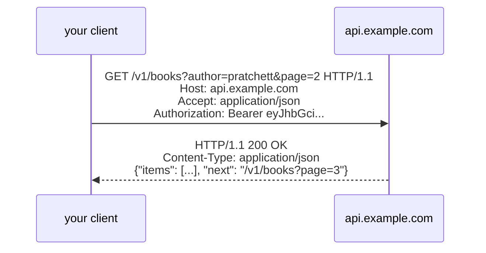
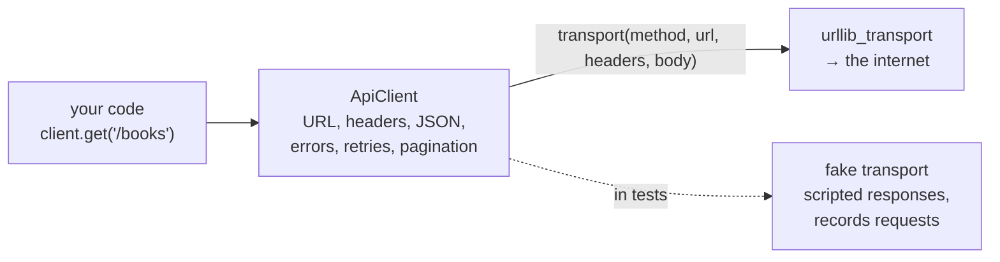

# Lesson 08 · Calling HTTP APIs

> **Level:** ⚫ Professional · **Time:** ~3 h · **Assignment:** [08 · API client](assignments/08-api-client/)

Payment providers, weather services, GitHub, your company's other services: modern software is glued
together with **HTTP APIs**. Calling one takes a single line. Calling one **reliably** takes more: set
timeouts, authenticate, handle error statuses, follow pagination, respect rate limits, and do all of it in
a way you can test without the real service. This lesson explains HTTP from the ground up and builds the
structure of a professional API client.

## What you will learn

- what an HTTP request and response consist of: method, URL, headers, body, status
- status codes and what your code should do with each class
- JSON APIs and REST conventions
- `urllib.request` from the standard library, and `requests` / `httpx`
- authentication with tokens, query strings, timeouts
- pagination and rate limits (`429`, `Retry-After`)
- a client design with an injectable **transport**, so it can be tested offline

---

## 1. Request and response

HTTP is a text protocol: the client sends a **request**, the server answers with a **response**.



| Part | Request | Response |
|---|---|---|
| first line | **method** + **path** (+ query string) | **status code** + reason |
| headers | `Accept`, `Authorization`, `Content-Type`, `User-Agent` | `Content-Type`, `Retry-After`, `Location`, `ETag` |
| body | data for `POST` / `PUT` / `PATCH` (often JSON) | the result (often JSON) |

The **URL** has parts too: `https://api.example.com:443/v1/books?author=pratchett&page=2` is scheme,
host, port, path and **query string**. Build query strings with `urllib.parse.urlencode`, which escapes
spaces, `&` and non-ASCII characters correctly.

## 2. Methods and status codes

| Method | Meaning | Idempotent (lesson 06) |
|---|---|---|
| `GET` | read | yes |
| `POST` | create, or "do something" | **no** |
| `PUT` | replace completely | yes |
| `PATCH` | change some fields | not necessarily |
| `DELETE` | delete | yes |

| Status class | Means | Your code should |
|---|---|---|
| `2xx` success | `200 OK`, `201 Created`, `204 No Content` | use the body (`204` has none) |
| `3xx` redirect | `301`, `302`, `304 Not Modified` | usually handled by the library |
| `4xx` **your** mistake | `400` bad request, `401` not logged in, `403` not allowed, `404` not found, `409` conflict, `422` invalid data | **not retry**: fix the request; raise a clear error |
| `429` too many requests | rate limit reached | **wait** (`Retry-After` header), then retry |
| `5xx` **their** problem | `500` bug, `502` / `504` gateway, `503` unavailable | retry carefully (`502`, `503`, `504`), with backoff |

## 3. REST and JSON

Most APIs follow **REST** conventions: URLs name **resources** (nouns), methods say what to do with them.

| Request | Means |
|---|---|
| `GET /books` | list books |
| `GET /books/42` | one book |
| `POST /books` with a JSON body | create a book → `201 Created` |
| `PATCH /books/42` with `{"year": 1988}` | change a field |
| `DELETE /books/42` | delete it → `204 No Content` |

Request and response bodies are **JSON**, with the header `Content-Type: application/json`. Errors
usually come back as JSON too, for example `{"error": "title is required"}` with status `422`.

## 4. `urllib.request`: HTTP with the standard library

```python
import json
import urllib.request
from urllib.error import HTTPError
from urllib.parse import urlencode

url = "https://api.example.com/v1/books?" + urlencode({"author": "Terry Pratchett", "page": 2})
request = urllib.request.Request(url, headers={"Accept": "application/json", "Authorization": f"Bearer {token}"})

try:
    with urllib.request.urlopen(request, timeout=10) as response:      # ALWAYS a timeout
        status = response.status                                       # → 200
        data = json.loads(response.read())
except HTTPError as error:                     # urllib raises for 4xx and 5xx ...
    status, body = error.code, error.read()    # ... but the error IS the response: status and body are there
```

A `POST` with a JSON body:

```python
body = json.dumps({"title": "Mort", "year": 1987}).encode()
request = urllib.request.Request(url, data=body, method="POST",
                                 headers={"Content-Type": "application/json"})
```

### `requests` and `httpx`

Most projects use a third-party library, which handles sessions, connection reuse, redirects, encodings
and JSON with less code:

```python
import httpx                                           # or: import requests (same API, sync only)

with httpx.Client(base_url="https://api.example.com/v1", timeout=10,
                  headers={"Authorization": f"Bearer {token}"}) as client:
    response = client.get("/books", params={"author": "Terry Pratchett"})
    response.raise_for_status()                        # raises for 4xx / 5xx
    books = response.json()
```

`httpx` also has an `AsyncClient` for asyncio (Advanced lesson 11). `requests` has **no default timeout**:
without `timeout=`, a call can hang forever.

## 5. Authentication

| Scheme | Header | Used by |
|---|---|---|
| API key | `X-API-Key: abc123` (name varies) | many simple APIs |
| Bearer token | `Authorization: Bearer <token>` | OAuth 2, GitHub, most modern APIs |
| Basic | `Authorization: Basic base64(user:password)` | older APIs, internal tools |

Tokens come from configuration (lesson 05), never from the code, never in the URL. Only send them over
`https://`.

## 6. Pagination

An API never returns a million items at once. It returns a **page** and tells you how to get the next:

| Style | The response contains | Next request |
|---|---|---|
| page number | `"page": 2, "pages": 9` | `?page=3` |
| offset | `"offset": 40, "limit": 20` | `?offset=60&limit=20` |
| cursor / next link | `"next": "/v1/books?cursor=eyJpZCI6NDJ9"` | exactly that URL |

Cursor pagination is the most robust: it does not skip or repeat items when data changes between pages.
A **generator** (Intermediate lesson 06) hides pagination from the caller completely:

```python
def iter_books(client):
    path = "/books"
    while path:
        page = client.get(path)
        yield from page["items"]
        path = page["next"]                    # None on the last page ends the loop

for book in iter_books(client):                # pages are fetched lazily, as the loop needs them
    ...
```

## 7. Rate limits

APIs limit how many requests a client may send ("60 per minute"). Above the limit, the server answers
`429 Too Many Requests`, usually with a **`Retry-After`** header: the number of seconds to wait. A good
client waits that long and tries again, a limited number of times (lesson 06). It also avoids the limit in
the first place: cache responses, request larger pages, do not poll in a tight loop.

## 8. A testable client: inject the transport

Tests must not call the real API: it is slow, needs credentials, changes its data, and may charge money.
Separate **what** to send (URL, headers, JSON, error handling, pagination: your logic) from **how** to send
it (the network: a **transport** function). Production passes the real transport, tests pass a fake:



```python
def fake_transport(method, url, headers, body):
    sent.append((method, url))
    return Response(200, {"content-type": "application/json"}, b'{"items": [], "next": null}')

client = ApiClient("https://api.example.com/v1", transport=fake_transport)
```

The transport itself stays tiny, and one integration test against a local test server checks it. Libraries
offer the same idea: `httpx.MockTransport`, `responses` and `respx` for `requests` and `httpx`.

---

## Common mistakes

**No timeout.** One slow API freezes your program. Every call gets one.

**Treating every non-200 the same.** Retrying a `400` is pointless; failing on a `429` without waiting is
rude. Decide per status class.

**Building URLs with `+` and f-strings.** Spaces, `&` and `ü` in values break the query string. Use
`urlencode` (or `params=`).

**Tokens in the URL or the code.** They end up in logs and Git. Headers and configuration.

**Loading all pages into a list** when you only need the first matches. Use a generator.

**Tests that hit the real API.** Slow and flaky. Inject the transport, and test it once against a local server.

## Try it yourself

1. Print `urlencode({"q": "Terry Pratchett & co", "page": 2})`.
2. Start `python -m http.server 8000` in a folder and fetch `http://127.0.0.1:8000/` with `urllib.request.urlopen`. Print `response.status` and `response.headers["Content-Type"]`.
3. Fetch a path that does not exist and catch the `HTTPError`. What are `error.code` and `error.headers`?
4. Write a fake transport that returns two pages and use `iter_books` with it.
5. Call `urlopen` on a non-routable address like `http://10.255.255.1` with `timeout=1`. What is raised?

## Summary

- A request is method + URL + headers + body; a response is status + headers + body.
- `2xx` success; `4xx` the client's fault (do not retry), `429` wait and retry, `5xx` retry carefully.
- REST: resources as URLs, methods as verbs, JSON bodies.
- `urllib.request` works everywhere; `httpx` / `requests` are nicer. Always set a timeout; escape query strings with `urlencode`.
- Tokens go in headers and come from configuration.
- Hide pagination behind a generator; respect `Retry-After`.
- Inject the transport: fakes in unit tests, one integration test for the real one.

## Assignment

➡️ **[08 · API client](assignments/08-api-client/)**: a JSON API client with typed errors, retries on `429` and `503`, pagination as a generator, and a real `urllib` transport tested against a local server.

---

<p align="center">
  <a href="../07-databases/">← Previous: 07 · Databases</a> · <a href="../README.md">Professional overview</a> · <a href="../09-building-a-web-api/">Next: 09 · Building a web API →</a>
</p>
