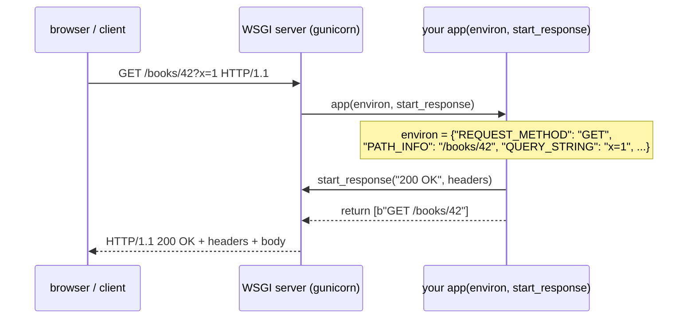
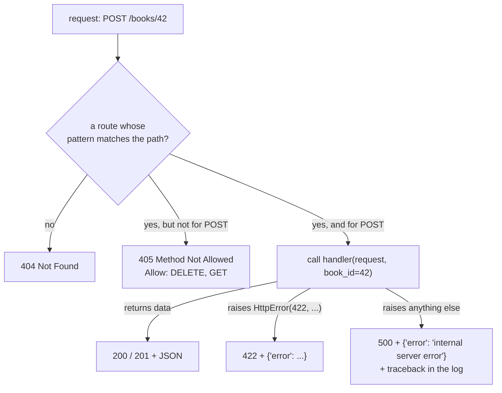

# Lesson 09 · Building a web API

> **Level:** ⚫ Professional · **Time:** ~3.5 h · **Assignment:** [09 · Micro framework](assignments/09-micro-framework/)

In lesson 08 you called APIs. Now you build one. Frameworks like Flask, FastAPI and Django make that look
like magic: a decorator, a function, and a URL works. Underneath, every Python web framework speaks the
same small protocol with the web server, and once you have seen it, frameworks stop being magic. This
lesson shows that protocol (**WSGI**), builds routing, requests, responses, validation, error handling and
middleware on top of it, and then shows how the big frameworks package the same ideas.

## What you will learn

- how a web server and a Python application talk: WSGI's `environ` and `start_response`
- routing URLs with path parameters to handler functions
- reading a request: method, path, query string, headers, JSON body
- answering with the right status code and a JSON body
- validation (`400`, `422`), not found (`404`), wrong method (`405`), server errors (`500`)
- middleware: code that wraps every request
- running and testing the app, and choosing a framework (Flask, FastAPI, Django)

---

## 1. Server and application

A web **server** (gunicorn, uWSGI, Python's `wsgiref`) handles the network: it accepts connections, parses
HTTP and writes bytes back. Your **application** handles the meaning: which URL does what. **WSGI** (Web
Server Gateway Interface, PEP 3333) is the contract between them. A WSGI application is just a
**callable** with two arguments:

```python
def app(environ, start_response):
    # environ: a dict describing the request
    # start_response: a function to call with the status and the headers
    start_response("200 OK", [("Content-Type", "text/plain; charset=utf-8")])
    return [f"{environ['REQUEST_METHOD']} {environ['PATH_INFO']}\n".encode()]   # an iterable of bytes
```



| `environ` key | Contains |
|---|---|
| `REQUEST_METHOD` | `"GET"`, `"POST"`, … |
| `PATH_INFO` | the path, without the query string: `"/books/42"` |
| `QUERY_STRING` | `"x=1&sort=year"` (may be missing or empty) |
| `CONTENT_TYPE`, `CONTENT_LENGTH` | type and size of the body (strings; may be missing) |
| `HTTP_*` | every other header: `Authorization` → `HTTP_AUTHORIZATION`, `X-Request-Id` → `HTTP_X_REQUEST_ID` |
| `wsgi.input` | a file-like object to `read(CONTENT_LENGTH)` the body from |

Run it with the standard library's reference server (fine for development, not for production):

```python
from wsgiref.simple_server import make_server

make_server("127.0.0.1", 8000, app).serve_forever()
```

**ASGI** is the asynchronous successor (used by FastAPI, Starlette and Django's async views, run by
uvicorn): the same idea, with `async` functions and support for WebSockets.

## 2. Routing

A **router** maps a method and a path to a **handler** function. Paths contain **parameters**:

```python
app = App()

@app.route("GET", "/books/<int:book_id>")
def get_book(request, book_id):
    book = repo.get_book(book_id)                   # book_id arrives as an int
    if book is None:
        raise HttpError(404, f"book {book_id} not found")
    return book                                      # → 200 with a JSON body
```

Under the hood, each pattern is compiled to a regular expression once, when the route is registered:
`/books/<int:book_id>` becomes `^/books/(?P<book_id>\d+)$`, and the matched groups become keyword
arguments. Flask uses the same `<int:name>` syntax; FastAPI writes `/books/{book_id}` and takes the type
from the function's type hint.



## 3. Requests and responses

A **request object** wraps the `environ` dict, so handlers do not dig through it:

```python
request.method            # "POST"
request.path              # "/books"
request.query             # {"sort": "year"}         from QUERY_STRING
request.headers           # {"content-type": "application/json", "authorization": "Bearer ..."}
request.json()            # the decoded body, or HttpError(400) if it is not valid JSON
```

A JSON **response** needs three things: a status line (`"201 Created"`, the reason phrase from
`http.HTTPStatus(201).phrase`), headers (`Content-Type: application/json; charset=utf-8` and a
`Content-Length`) and the body bytes.

| Situation | Status |
|---|---|
| read something | `200 OK` |
| created something | `201 Created` (often with a `Location` header) |
| deleted, nothing to say | `204 No Content`, empty body |
| body is not valid JSON | `400 Bad Request` |
| not logged in / not allowed | `401` / `403` |
| no such resource | `404 Not Found` |
| path exists, method does not | `405 Method Not Allowed`, with an `Allow` header |
| valid JSON, invalid data (`year: "soon"`) | `422 Unprocessable Entity` |
| a bug in your code | `500 Internal Server Error` |

## 4. Validation and errors

**Never trust the request body.** Check every field: present, right type, sensible value. Report what is
wrong in a way the client can fix:

```python
@app.route("POST", "/books")
def create_book(request):
    data = request.json()
    if not isinstance(data, dict) or not isinstance(data.get("title"), str) or not data["title"].strip():
        raise HttpError(422, "title is required")
    book_id = repo.add_book(data["title"].strip(), data.get("author", "unknown"))
    return {"id": book_id}, 201
```

An **unexpected** exception must never show its traceback to the client: it reveals your code and maybe
secrets. The client gets a generic `500`; the full traceback goes into **your** log (lesson 04). That is
exactly the "boundary" from lesson 06.

Libraries like **pydantic** (built into FastAPI) and **marshmallow** do validation declaratively, from a
class with type hints.

## 5. Middleware

**Middleware** wraps the whole application to add behaviour to **every** request: logging, timing,
authentication, compression, CORS headers, request ids. In WSGI, a middleware is just an application
that calls another one, the decorator pattern from Advanced lesson 01 applied to apps:

```python
def timing_middleware(app):
    def wrapped(environ, start_response):
        start = time.perf_counter()
        try:
            return app(environ, start_response)
        finally:
            log.info("%s %s took %.1f ms", environ["REQUEST_METHOD"], environ["PATH_INFO"],
                     (time.perf_counter() - start) * 1000)
    return wrapped

app = timing_middleware(request_id_middleware(App()))      # layers, like an onion
```

To **change the response** (add a header), the middleware passes its own `start_response` that adds the
header and then calls the server's.

## 6. Testing

A WSGI app is a function, so tests can call it directly, with no server and no network:

```python
from wsgiref.util import setup_testing_defaults

environ = {"REQUEST_METHOD": "GET", "PATH_INFO": "/books/42"}
setup_testing_defaults(environ)                 # fills in the remaining required keys
captured = {}
body = b"".join(app(environ, lambda status, headers: captured.update(status=status, headers=headers)))
```

Frameworks ship a **test client** that does exactly this: `app.test_client()` in Flask, `TestClient(app)`
in FastAPI, `self.client` in Django tests.

## 7. Choosing a framework

| | **Flask** | **FastAPI** | **Django** |
|---|---|---|---|
| style | small core, add what you need | type hints drive validation and docs | "batteries included" |
| protocol | WSGI | ASGI (async) | WSGI and ASGI |
| validation | extensions | pydantic, built in | forms, serializers (Django REST framework) |
| database | your choice (often SQLAlchemy) | your choice | its own ORM and migrations |
| automatic API docs | extensions | yes (OpenAPI, Swagger UI) | with DRF |
| good for | small services, learning | JSON APIs, async I/O | full web applications with admin, auth, ORM |

Everything from this lesson maps directly onto them: routes with parameters, request objects, JSON
responses with status codes, validation, error handlers, middleware, and a test client. In production, a
real server (gunicorn, uvicorn) runs several worker processes behind a reverse proxy (nginx, a cloud load
balancer) that handles HTTPS.

---

## Common mistakes

**Tracebacks in responses.** `debug=True` in production shows your code, settings and sometimes secrets to
anyone. Generic `500` for clients, details in your log.

**Trusting input.** A missing field raises `KeyError` → `500`. Validate and answer `422` with a reason.

**`200` for everything.** Clients and monitoring rely on status codes. `201` for created, `404` for
missing, `4xx` for client mistakes, `5xx` only for your bugs.

**Forgetting `Content-Length` or the charset.** Some clients hang or misread the body.

**The development server in production.** `wsgiref` and `flask run` handle one request at a time and are
not hardened. Use gunicorn or uvicorn.

**Blocking calls in async handlers** (FastAPI). Same rule as Advanced lesson 11: they freeze every request.

## Try it yourself

1. Run the `app` from section 1 with `make_server` and open `http://127.0.0.1:8000/hello?x=1` in a browser. Print `environ` to see every key.
2. Return a body without calling `start_response`. What does the server do?
3. Write a router with two routes using a dict `{(method, path): handler}`, then extend it with a regular expression for `<int:id>`.
4. Write a middleware that adds `X-Powered-By: python` to every response.
5. `pip install flask`, write the same two routes with `@app.get(...)`, and test them with `app.test_client()`.

## Summary

- WSGI: an app is `app(environ, start_response)` returning an iterable of bytes; the server does the network.
- A router compiles path patterns to regular expressions and calls handlers with typed parameters.
- Request objects wrap `environ`; JSON responses need a status line, `Content-Type`, `Content-Length` and bytes.
- Use status codes precisely: `201`, `204`, `400`, `404`, `405` with `Allow`, `422`, and `500` only for bugs.
- Validate every input; never leak tracebacks; log unexpected errors at the boundary.
- Middleware wraps the app for cross-cutting concerns; apps are tested by calling them directly.
- Flask, FastAPI and Django package these same ideas; run them under gunicorn or uvicorn in production.

## Assignment

➡️ **[09 · Micro framework](assignments/09-micro-framework/)**: build a tiny WSGI framework with typed path parameters, request parsing, JSON responses, proper `404` / `405` / `422` / `500` handling and a request-id middleware, then serve it for real.

---

<p align="center">
  <a href="../08-calling-http-apis/">← Previous: 08 · Calling HTTP APIs</a> · <a href="../README.md">Professional overview</a> · <a href="../10-architecture/">Next: 10 · Architecture →</a>
</p>
