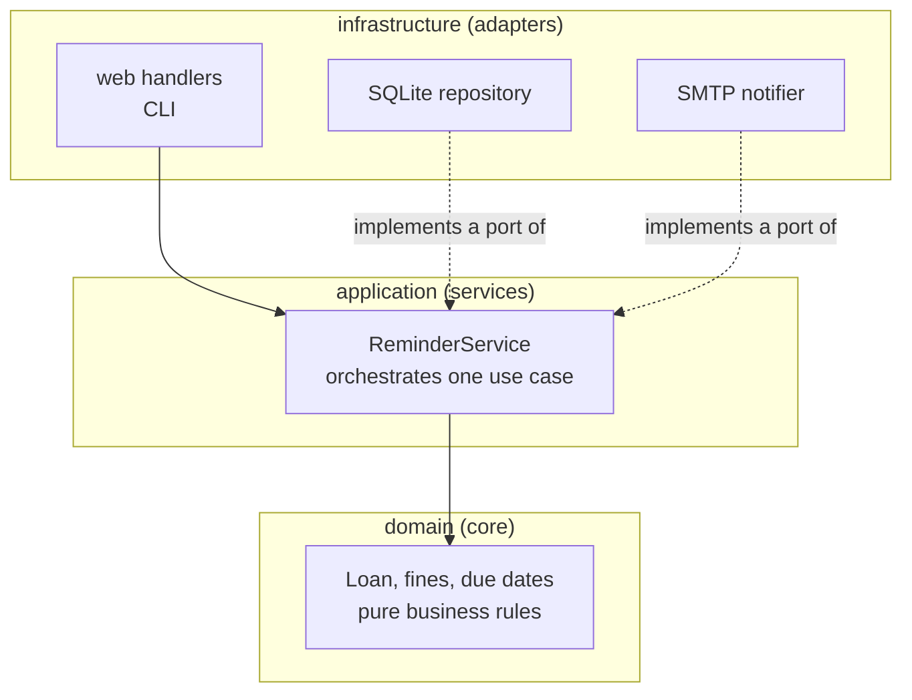
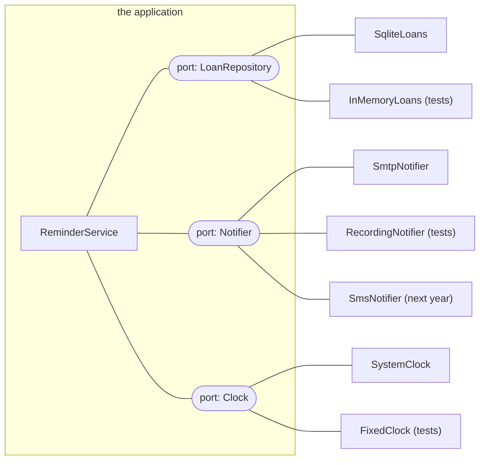
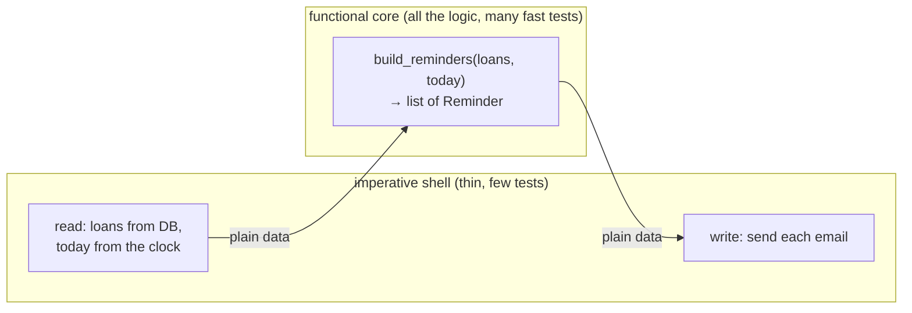

# Lesson 10 · Architecture

> **Level:** ⚫ Professional · **Time:** ~3 h · **Assignment:** [10 · Ports and adapters](assignments/10-ports-and-adapters/)

Every program works on day one. Architecture is about day 300: can you still change it? Can you swap the
database, add a second way to send notifications, test the business rules without a mail server? The
answer depends less on clever patterns than on a few simple decisions about **what depends on what**.
This lesson covers those decisions: layers, the dependency rule, dependency injection, ports and
adapters, and the most useful of them all, keeping the logic pure and pushing I/O to the edges.

## What you will learn

- coupling and cohesion, the two forces behind every design decision
- layers, and the rule that dependencies point inwards
- dependency injection and the composition root
- ports and adapters (hexagonal architecture) with `typing.Protocol`
- a functional core in an imperative shell
- how much architecture is enough

---

## 1. Coupling and cohesion

| | Means | You want |
|---|---|---|
| **coupling** | how much one part must know about another to work | **low**: change one part without touching the others |
| **cohesion** | how much the things inside one part belong together | **high**: one module, one job |

A tangled function shows both problems at once:

```python
def send_overdue_reminders(db_path):
    conn = sqlite3.connect(db_path)                          # knows the database
    today = datetime.date.today()                            # knows the real clock
    for name, email, title, loaned_on in conn.execute("SELECT ..."):
        due = datetime.date.fromisoformat(loaned_on) + datetime.timedelta(days=14)
        if today > due:                                      # the business rule, buried in the middle
            fine = min(1000, (today - due).days * 25)
            with smtplib.SMTP("mail.example.com") as smtp:   # knows the mail server
                smtp.sendmail("library@example.com", email, f"... {fine} ...")
```

Twelve lines, and to test whether the fine is right you need a database file, a fake date and a mail
server. To send reminders by SMS you must edit the function that calculates fines. Everything is coupled
to everything.

## 2. Layers and the dependency rule

Split the program by **responsibility**:



| Layer | Contains | Knows about |
|---|---|---|
| **domain** | business objects and rules: what a loan is, when it is overdue, how much the fine is | nothing else: no SQL, no HTTP, no clock |
| **application** | use cases: "send reminders", "lend a book"; coordinates domain and ports | the domain, and abstract **ports** |
| **infrastructure** | databases, web frameworks, mail servers, files, the clock | everything it needs; plugs into the ports |

**The dependency rule:** source code dependencies point **inwards**. The domain imports nothing from the
outer layers. The service talks to "something that can send a message", not to `smtplib`. That keeps the
valuable, slow-changing part (the rules) independent of the replaceable, fast-changing part (the
technology).

## 3. Dependency injection

A class that **creates** its own dependencies is coupled to them:

```python
class ReminderService:
    def __init__(self):
        self.notifier = SmtpNotifier("mail.example.com")     # ❌ hard-wired: every test sends email
```

**Inject** them instead: the class receives what it needs.

```python
class ReminderService:
    def __init__(self, loans, notifier, clock):              # ✅ given from outside
        self.loans, self.notifier, self.clock = loans, notifier, clock
```

No framework is needed: it is just passing arguments. Somewhere, all the real objects must be created
and connected. That one place is the **composition root**, usually `main()`:

```python
def main():
    settings = load_settings()                               # lesson 05
    conn = connect(settings.database_url)                    # lesson 07
    service = ReminderService(
        loans=SqliteLoans(conn),
        notifier=SmtpNotifier(settings.smtp_host),
        clock=SystemClock(),
    )
    service.run()
```

Tests build the same service with fakes, in one line, and every dependency is visible in the signature.

## 4. Ports and adapters

A **port** describes what the application needs from the outside world, in its own terms. An **adapter**
implements a port for one technology. In Python, a port is a `typing.Protocol` (Advanced lesson 07): any
class with the right methods fits, without inheriting from anything.

```python
from typing import Protocol

class Notifier(Protocol):                                    # the port
    def send(self, to: str, subject: str, body: str) -> None: ...

class SmtpNotifier:                                          # an adapter for production
    def __init__(self, host): self.host = host
    def send(self, to, subject, body):
        with smtplib.SMTP(self.host) as smtp: ...

class RecordingNotifier:                                     # an adapter for tests (a fake, lesson 03)
    def __init__(self): self.sent = []
    def send(self, to, subject, body): self.sent.append((to, subject, body))
```



Adding SMS next year means writing **one new adapter**. The service, the rules and their tests do not
change. This shape is called **hexagonal architecture** or **ports and adapters**.

## 5. Functional core, imperative shell

The most practical form of all this: put the **decisions** into pure functions (same input, same output,
no I/O), and keep the **I/O** in a thin shell around them.



```python
def build_reminders(loans, today, grace_days=14):            # pure: decides everything
    ...
    return [Reminder(to=..., subject=..., body=...), ...]

class ReminderService:                                        # shell: only moves data
    def run(self):
        reminders = build_reminders(self.loans.open_loans(), self.clock.today())
        for reminder in reminders:
            self.notifier.send(reminder.to, reminder.subject, reminder.body)
```

Pure functions are the easiest code there is to test: no setup, no mocks, no cleanup, just
`assert build_reminders(loans, date(2026, 11, 1)) == [...]`. The shell is so simple that a couple of
tests with fakes are enough.

## 6. How much architecture?

Patterns have a cost: more files, more indirection, more names. Match the structure to the program:

| Program | Enough |
|---|---|
| a 100-line script | functions; maybe `main()` and a pure function or two |
| a small tool or service | modules by responsibility; pure core; inject the clock, the network and the database |
| a large application, several teams | explicit layers, ports and adapters, package boundaries, maybe several services |

Signs you need more: tests need a database for every business rule; one change touches ten files;
nobody dares to touch a module. Signs you have too much: an interface with exactly one implementation and
no test fake, a "manager" that only forwards calls, three layers of wrappers around one SQL query. YAGNI, "you aren't gonna need
it": add structure when a real need appears, not in advance.

---

## Common mistakes

**Creating dependencies inside the class.** `self.db = sqlite3.connect(...)` in `__init__`: untestable
without a real database. Inject it.

**Business rules in the web handler or the SQL.** The fine is calculated in a view function or in a SQL
`CASE`; reusing it from the CLI means copying it. Put rules in the domain.

**The domain imports the infrastructure.** `from app.db import session` inside `loan.py`. Dependencies
point inwards.

**Reading the clock in the middle of the logic.** `date.today()` deep inside a function makes it
untestable on any other day. Pass `today` in.

**Abstractions for everything.** A Protocol, a factory and a registry for something with one
implementation and no tests. Add the port when the second adapter (often the test fake) appears.

## Try it yourself

1. Take the tangled function from section 1 and list everything it is coupled to.
2. Write `is_overdue(loaned_on, today, grace_days=14)` as a pure function and test it with three dates.
3. Write a `Clock` Protocol, a `SystemClock` and a `FixedClock`, and check with mypy that both fit the protocol.
4. Pick one of your earlier capstones. Which functions are pure? Which ones mix logic and I/O?
5. Draw the dependency arrows of a project you know. Does any arrow point from the core outwards?

## Summary

- Aim for low coupling and high cohesion: one part, one job; parts that know little about each other.
- Layers: domain (rules), application (use cases), infrastructure (technology); dependencies point inwards.
- Inject dependencies through the constructor; wire the real ones in one composition root.
- Ports are Protocols in the application's language; adapters implement them per technology, fakes for tests.
- Functional core, imperative shell: pure functions decide, a thin shell does the I/O.
- Use as much structure as the program needs, and no more.

## Assignment

➡️ **[10 · Ports and adapters](assignments/10-ports-and-adapters/)**: untangle a legacy reminder function into a pure core, ports, adapters for SQLite and for tests, and a small service.

---

<p align="center">
  <a href="../09-building-a-web-api/">← Previous: 09 · Building a web API</a> · <a href="../README.md">Professional overview</a> · <a href="../11-security/">Next: 11 · Security →</a>
</p>
