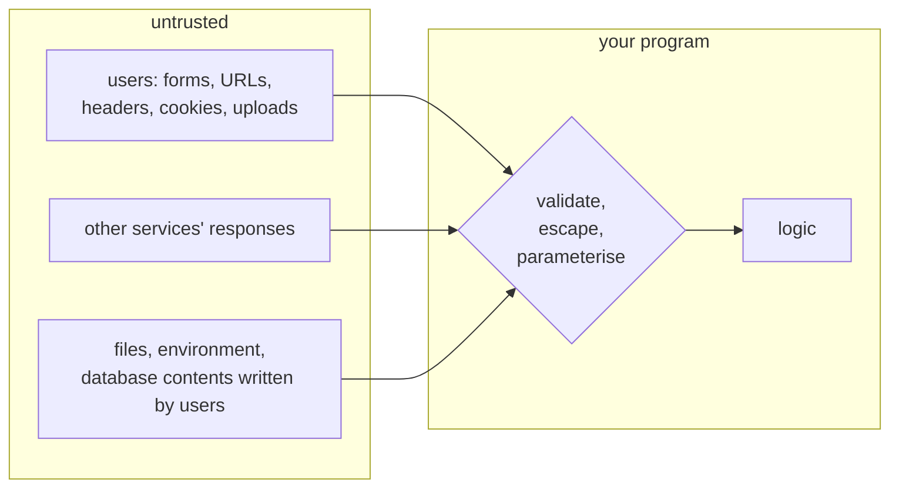
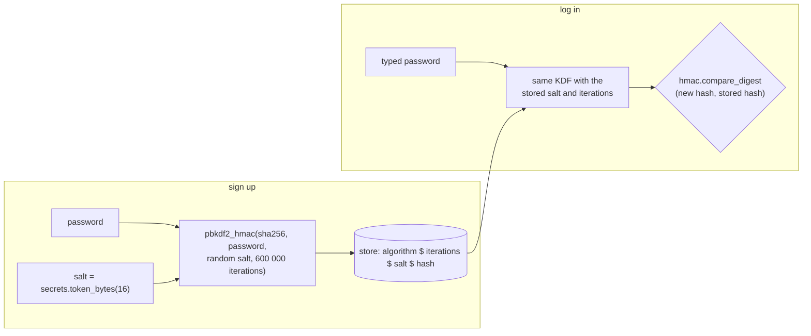
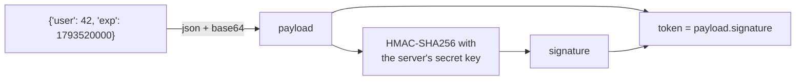

# Lesson 11 · Security

> **Level:** ⚫ Professional · **Time:** ~3 h · **Assignment:** [11 · Security kit](assignments/11-security-kit/)

Every program that accepts input from the outside is a target: a web form, an uploaded file, an API
request, even a config value. Most security bugs are not exotic. They are the same few mistakes, made
again and again: input that becomes code, a path that leaves its folder, a password stored badly, a
comparison that leaks timing, a secret in a log. This lesson covers those mistakes, the standard-library
tools that prevent them, and the habits that keep a project safe over time.

## What you will learn

- thinking in trust boundaries, and the OWASP Top 10
- injection: SQL, shell commands, HTML, and how to prevent each
- path traversal and unsafe deserialization (`pickle`, `yaml.load`)
- `secrets` instead of `random` for anything security-related
- storing passwords: salt, slow hashing, `hashlib.pbkdf2_hmac`, and why never to encrypt them
- signing data with `hmac`, constant-time comparisons, and how JWTs work
- TLS, dependencies, and tools that find problems for you

---

## 1. Trust boundaries

A **trust boundary** is where data enters your program from somewhere you do not control. Everything that
crosses it is **untrusted** until checked, however friendly it looks:



The **OWASP Top 10** lists the most common web security risks. Most of them come down to: broken access
control (users reach data they should not), cryptographic failures (bad password storage, no TLS),
**injection**, insecure design, misconfiguration (debug mode in production), vulnerable dependencies,
broken authentication, and missing logging. This lesson covers the ones you can fix in Python code.

## 2. Injection

**Injection** happens when untrusted data is put into something that a different program **interprets**:
SQL for the database, a shell command line, HTML for the browser. The data then becomes **code**.

| Where | Vulnerable | Safe |
|---|---|---|
| SQL (lesson 07) | `f"... WHERE name = '{name}'"` | `execute("... WHERE name = ?", (name,))` |
| shell | `subprocess.run(f"convert {filename} out.png", shell=True)` | `subprocess.run(["convert", filename, "out.png"])` |
| HTML | `f"<p>Hello {name}</p>"` | `f"<p>Hello {html.escape(name)}</p>"`, or a template engine that escapes automatically |

The safe versions all follow one principle: **keep code and data separate**. A parameter, an argument
list and an escaped string can only ever be data.

```python
filename = "report; rm -rf ~"
subprocess.run(f"wc -l {filename}", shell=True)       # ❌ the shell runs TWO commands
subprocess.run(["wc", "-l", filename])                # ✅ one program, one odd file name

html.escape('<script>alert("hi")</script>')
# → '&lt;script&gt;alert(&quot;hi&quot;)&lt;/script&gt;'      shown as text, never run
```

If you truly need a shell, quote every value with `shlex.quote(value)` → `'report; rm -rf ~'`. But the
list form is simpler and safer. Template engines like Jinja2 and Django templates escape HTML by default;
never switch that off for user data.

## 3. Path traversal

A web app serves files from an upload folder: `open(UPLOADS / name)`. An attacker asks for
`name = "../../etc/passwd"`, and the path walks out of the folder. An absolute `name` like `/etc/passwd`
is even worse: `Path("/srv/uploads") / "/etc/passwd"` **is** `/etc/passwd`.

The fix: build the full path, **resolve** it (follow `..` and symbolic links), and check that the result
is still inside the base folder:

```python
base = Path("/srv/uploads").resolve()
target = (base / name).resolve()
if not target.is_relative_to(base):                   # Python 3.9+
    raise PermissionError("path escapes the upload folder")
```

Better still, do not use client-supplied names as file names at all: store uploads under a generated id
and keep the original name in the database.

## 4. Unsafe deserialization

`pickle.loads(data)` can run **any code** the data asks for: a pickle is a small program, not just data.
Never unpickle anything from an untrusted source (a request, a cookie, a downloaded file). The same holds
for `yaml.load` without a safe loader (`yaml.safe_load` is fine), and for `eval` and `exec` on input.
Use JSON for data from outside.

## 5. Randomness: `secrets`, not `random`

The `random` module is **predictable**: after seeing enough outputs, an attacker can compute the next
ones. It is made for simulations and games. For tokens, password reset links, session ids and API keys,
use `secrets`, which draws from the operating system's secure generator:

```python
import secrets

secrets.token_urlsafe(32)      # → 'Drmhze6EPcv0fN_81Bj-nA...' (43 characters, URL-safe)
secrets.token_hex(4)           # → '8f2a01bc'
secrets.choice("abcdef")       # a secure random choice
```

## 6. Storing passwords

Never store passwords as plain text, and never **encrypt** them: whoever gets the key gets every
password. Store a **hash** instead, which cannot be reversed. But not just any hash:

| Approach | Problem |
|---|---|
| plain text | a database leak reveals every password |
| `sha256(password)` | **fast**: a graphics card tests billions of guesses per second; the same password always gives the same hash, so precomputed tables work |
| `sha256(salt + password)` | the **salt** (random, per user) stops precomputed tables and hides equal passwords, but it is still fast |
| **slow KDF** with salt: PBKDF2, scrypt, bcrypt, Argon2 | ✅ each guess costs real time and memory; the cost can grow with hardware |



Store the algorithm and the number of iterations **with** the hash. Then you can raise the iterations
later: when a user logs in with a hash that uses fewer, compute a new one and save it ("rehash on
login"). In production, use a library like `argon2-cffi` or `passlib`, or your framework's (Django
already does all of this). The standard library has PBKDF2 (`hashlib.pbkdf2_hmac`) and scrypt
(`hashlib.scrypt`).

## 7. Timing attacks and signatures

`stored == given` stops at the **first different character**. Comparing many guesses and measuring the
time reveals, character by character, how much of a secret was right. For secrets, always use
`hmac.compare_digest(a, b)`: its time does not depend on where they differ.

An **HMAC** is a signature made with a secret key: `hmac.new(key, message, "sha256").digest()`. Anyone
can read the message, but only someone with the key can produce a valid signature, and any change to the
message breaks it. That lets a server hand data to a client (a session in a cookie, a password-reset link)
and trust it when it comes back:



To verify, the server recomputes the signature from the payload and compares with `compare_digest`, then
checks the expiry time. This is the core of a **JWT** (JSON Web Token), which adds a header naming the
algorithm. Signed is not encrypted: never put secrets into the payload. Use the `PyJWT` library for real
JWTs, and always tell it which algorithms to accept.

## 8. TLS, dependencies and tools

- **TLS everywhere.** Only `https://` for anything with credentials. Never turn off certificate
  verification (`verify=False` in `requests`, an unverified SSL context): it lets anyone in the middle
  read and change the traffic.
- **Dependencies are code you run.** Check them for known vulnerabilities with `pip-audit`, let
  Dependabot or Renovate propose updates, keep a lock file with hashes (lesson 01), and double-check
  package names: `reqeusts` (typosquatting) is not `requests`.
- **Let tools look.** `bandit` and ruff's `S` rules (lesson 02) flag `shell=True`, `pickle`, `eval`,
  hard-coded passwords and SQL built from strings. Secret scanners (gitleaks) check the Git history.
- **Least privilege.** The database user of a web app does not need `DROP TABLE`; a container does not
  need root.

---

## Common mistakes

**String-built SQL, shell commands or HTML.** Injection. Parameters, argument lists, escaping.

**`random` for tokens.** Predictable. Use `secrets`.

**Fast or unsalted password hashes** (`md5`, `sha256(password)`). Use a slow, salted KDF.

**`==` on secrets.** Timing leaks. Use `hmac.compare_digest`.

**`pickle.loads` or `yaml.load` on input.** Remote code execution. Use JSON or `yaml.safe_load`.

**Trusting a path from a client.** Resolve it and check it stays inside its folder.

**Detailed errors for clients.** Tracebacks and SQL errors tell attackers how your system works.

**`verify=False`.** "Just for now" becomes forever. Fix the certificate instead.

## Try it yourself

1. Run `subprocess.run(["echo", "a; echo b"])` and `subprocess.run("echo a; echo b", shell=True)`. Compare.
2. Print `(Path("/srv/uploads") / "/etc/passwd")` and `(Path("/srv/uploads") / "../x").resolve()`.
3. Time `hashlib.sha256(b"pw").digest()` and `hashlib.pbkdf2_hmac("sha256", b"pw", b"salt", 600_000)` with `timeit`. How many guesses per second does each allow?
4. Create an HMAC of `b"user=42"`, change one byte of the message, and compare the signatures.
5. `pip install pip-audit bandit` and run both on one of your projects.

## Summary

- Treat every input that crosses a trust boundary as untrusted until validated.
- Keep code and data apart: SQL parameters, argument lists for `subprocess`, `html.escape` or auto-escaping templates.
- Resolve paths and check `is_relative_to`; never unpickle untrusted data.
- `secrets` for tokens; `random` only for simulations.
- Passwords: random salt + slow KDF (PBKDF2, scrypt, bcrypt, Argon2), algorithm and cost stored with the hash; rehash on login.
- Compare secrets with `hmac.compare_digest`; sign data with HMAC; signed is not encrypted.
- TLS with verification, audited dependencies, linters and scanners, least privilege.

## Assignment

➡️ **[11 · Security kit](assignments/11-security-kit/)**: a traversal-proof `safe_join`, PBKDF2 password hashing with verification and rehash detection, signed expiring tokens, and secret masking for logs.

---

<p align="center">
  <a href="../10-architecture/">← Previous: 10 · Architecture</a> · <a href="../README.md">Professional overview</a> · <a href="../12-git-ci-and-releases/">Next: 12 · Git, CI and releases →</a>
</p>
