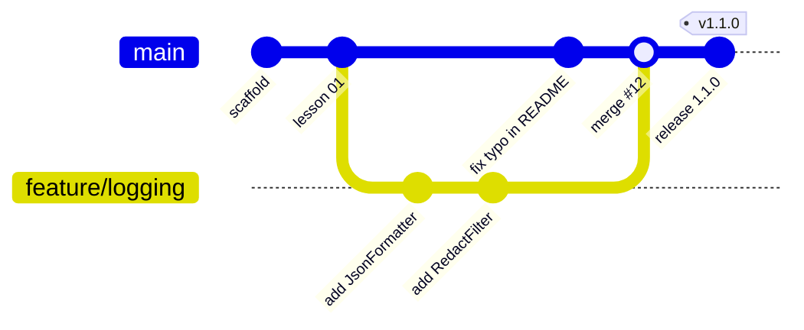
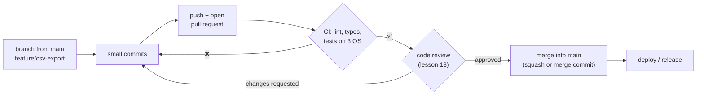
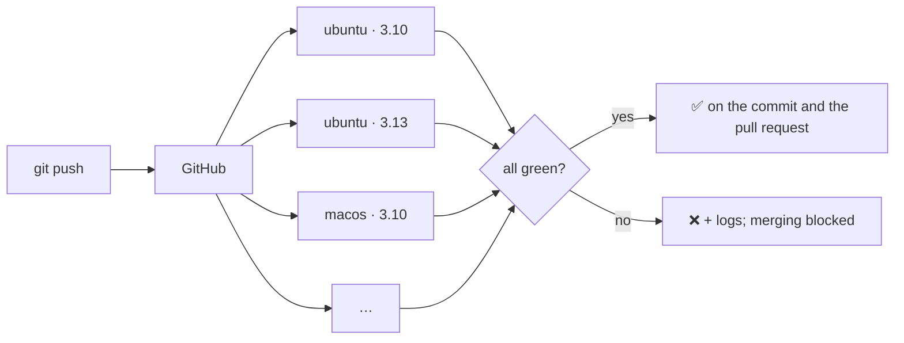
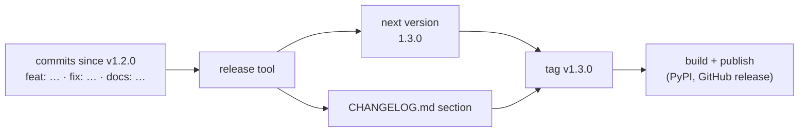

# Lesson 12 · Git, CI and releases

> **Level:** ⚫ Professional · **Time:** ~3 h · **Assignment:** [12 · Release notes](assignments/12-release-notes/)

Code in a team moves through a pipeline: a branch, commits, a pull request, automated checks, a review,
a merge, and eventually a release with a version number and a changelog. Each step exists to catch a
different kind of problem before users see it. This lesson covers how Git models your history, how teams
work with branches and pull requests, how to write commits that help the next reader, how CI runs your
checks on every push (this repository's own CI is the example), and how versions and changelogs can be
produced automatically from good commit messages.

## What you will learn

- Git's model: commits are snapshots, branches are movable pointers
- feature branches, pull requests, merge and rebase
- commit messages that explain *why*, and the Conventional Commits format
- continuous integration with GitHub Actions: workflows, jobs, matrices, secrets
- semantic versioning, changelogs, tags and automated releases

---

## 1. How Git sees your project

A **commit** is a snapshot of the whole project plus metadata (author, date, message) and a pointer to its
**parent** commit(s). Its id (`a7063e7…`) is a hash of all of that, so a commit can never change without
getting a new id. A **branch** is just a movable name pointing at one commit; `HEAD` is where you are.



| Command | Does |
|---|---|
| `git switch -c feature/logging` | create a branch and move to it |
| `git add -p` | stage changes piece by piece (review your own diff) |
| `git commit` | snapshot the staged changes |
| `git fetch` / `git pull --rebase` | get others' commits; replay yours on top |
| `git push -u origin feature/logging` | publish the branch |
| `git log --oneline --graph` | see the history as a graph |
| `git revert <id>` | a new commit that undoes an old one (safe on shared branches) |

Never rewrite history that others already have (`push --force` on `main`). On your own branch before
review, cleaning up with `git rebase -i` is fine.

## 2. Branches and pull requests

Most teams work like this:



- **Short-lived branches.** A branch that lives for weeks collects conflicts. Merge small pieces often;
  hide unfinished features behind a flag if needed ("trunk-based development").
- **Branch protection** on `main`: no direct pushes, CI must pass, at least one approval.
- **Merge vs rebase vs squash.** A merge commit keeps the branch's history; rebase replays it on top
  of `main` for a straight line; squash turns the whole pull request into one commit. Pick one per
  project and stick to it.

## 3. Commit messages

The diff shows **what** changed. The message must say **why**, for the person running `git blame` in two
years (possibly you):

```text
Retry rate-limited API calls with Retry-After             ← subject: imperative, ≤ 50–72 chars, no period

The exchange-rate API started answering 429 during the    ← body: why, and what you considered
nightly import. We now wait for the time the server
asks for, up to three retries, instead of failing the
whole import.

Refs #214                                                 ← footer: issues, breaking changes
```

| Bad | Better |
|---|---|
| `fix` | `Fix crash when the upload folder is empty` |
| `changes` | `Cache exchange rates for one hour` |
| `WIP`, `asdf` | (squash these before merging) |
| `Updated the function to use a set because it was slow` | `Use a set for member lookups (import took 40 s)` |

One logical change per commit: a commit that "fixes the bug, renames a module and updates the
formatting" cannot be reverted or reviewed in parts.

### Conventional Commits

Many projects use a machine-readable subject line, so tools can build changelogs and pick version numbers:

```text
<type>(<optional scope>)<optional !>: <description>

feat(cli): add --json output
fix: handle empty files
perf(db): add index on loans.book_id
docs: explain the retry settings
feat(api)!: remove the v1 endpoints              ← "!" marks a breaking change

refactor: split the client into transport and api

BREAKING CHANGE: ApiClient now needs a transport  ← a footer also marks a breaking change
```

| Type | Means | Release |
|---|---|---|
| `feat` | a new feature | **minor** |
| `fix` | a bug fix | **patch** |
| `perf` | a performance improvement | patch |
| `docs`, `test`, `refactor`, `style`, `chore`, `ci`, `build` | everything else | none |
| any type with `!` or a `BREAKING CHANGE:` footer | an incompatible change | **major** |

## 4. Continuous integration with GitHub Actions

**Continuous integration** (CI) runs your checks on a clean machine for every push and pull request.
"Works on my machine" stops being an argument. A **workflow** is a YAML file in `.github/workflows/`. This
repository's own one (slightly shortened) runs every test against every template solution, on three operating systems and two
Python versions:

```yaml
name: ci
on: [push, pull_request]                   # when to run

jobs:
  solutions:
    runs-on: ${{ matrix.os }}
    strategy:
      fail-fast: false                     # finish all combinations, even if one fails
      matrix:                              # 3 × 2 = 6 jobs, in parallel
        os: [ubuntu-latest, macos-latest, windows-latest]
        python: ["3.10", "3.13"]
    env:
      PLP_SOLUTIONS: "1"
    steps:
      - uses: actions/checkout@v4          # get the code
      - uses: actions/setup-python@v5      # install Python
        with:
          python-version: ${{ matrix.python }}
      - run: pip install -r requirements.txt
      - run: pytest -v                     # a non-zero exit code fails the job
```



A typical Python pipeline has these steps, fastest first so failures show up early: `ruff check`,
`ruff format --check`, `mypy`, `pytest --cov`, then build the package. Speed it up with caching
(`setup-python` can cache pip downloads; `astral-sh/setup-uv` caches uv). **Secrets** (a PyPI token, a
deploy key) are stored in the repository settings and reach the workflow as `${{ secrets.NAME }}`; they
are masked in logs and not given to pull requests from forks.

## 5. Versions, changelogs and releases

A **release** is a version of your software that users can install: a Git **tag** (`v1.4.0`), a package
on PyPI, a container image, a GitHub release page with notes.

**Semantic versioning** (Advanced lesson 12) gives the number meaning: `MAJOR.MINOR.PATCH`. Breaking change
→ major, new feature → minor, fix → patch. While the major version is `0`, the API is not considered
stable, and many projects bump the **minor** version for breaking changes.

A **changelog** (`CHANGELOG.md`) tells users what changed, grouped and in plain words, newest first:

```markdown
## 1.3.0 (2026-11-01)

### ⚠ Breaking changes
- **api:** remove the v1 endpoints

### Features
- **cli:** add --json output

### Bug fixes
- handle empty files
```

With Conventional Commits, both the next version and the changelog follow **mechanically** from the
commits since the last tag. Tools like **release-please**, **python-semantic-release** and **commitizen**
open a "release PR" that bumps the version and updates the changelog; merging it tags the release, and a
workflow builds the package and publishes it to PyPI (with **trusted publishing**, no token needed).



---

## Common mistakes

**Huge pull requests.** 2 000 changed lines get a rubber-stamp review. Keep them small and focused.

**Commit messages that say nothing.** `fix`, `update`, `wip`. Write the subject a reviewer needs.

**Force-pushing shared branches.** Others' work disappears. Rewrite only your own, unreviewed branch.

**CI that is red "as usual".** People stop looking, and real failures slip through. Fix or remove flaky tests.

**Secrets in workflow files.** Use repository secrets; never `echo` them.

**Releasing by hand from a laptop.** Unreproducible, easy to forget a step. Tag, and let CI build and publish.

**Editing the changelog after the fact.** Generate it from commits, or update it in the same pull request.

## Try it yourself

1. Run `git log --oneline --graph --all` in this repository. How many commits does each level have?
2. Create a branch, make two commits, and merge it once with `--no-ff` and once by rebasing first. Compare the graphs.
3. Rewrite the last five commit messages of one of your projects as Conventional Commits (on paper). Which version bump would they cause?
4. Open this repository's `.github/workflows/ci.yml` and its Actions tab on GitHub. Find the log of one job.
5. Add a workflow to one of your own repositories that runs `pytest` on push.

## Summary

- Commits are immutable snapshots with parents; branches are movable names; never rewrite shared history.
- Work on short-lived branches, open pull requests, protect `main` with CI and review.
- Messages: imperative subject, a body that explains why, one logical change per commit.
- Conventional Commits (`feat`, `fix`, `!`, `BREAKING CHANGE:`) make history machine-readable.
- GitHub Actions workflows run checks on every push; matrices cover OS and Python versions; secrets stay in settings.
- Semantic versions and a changelog can be derived automatically from commits; releases are tagged and published by CI.

## Assignment

➡️ **[12 · Release notes](assignments/12-release-notes/)**: parse Conventional Commits, compute the next semantic version, and generate the changelog section, the core of a release tool.

---

<p align="center">
  <a href="../11-security/">← Previous: 11 · Security</a> · <a href="../README.md">Professional overview</a> · <a href="../13-code-review-and-documentation/">Next: 13 · Code review and documentation →</a>
</p>
