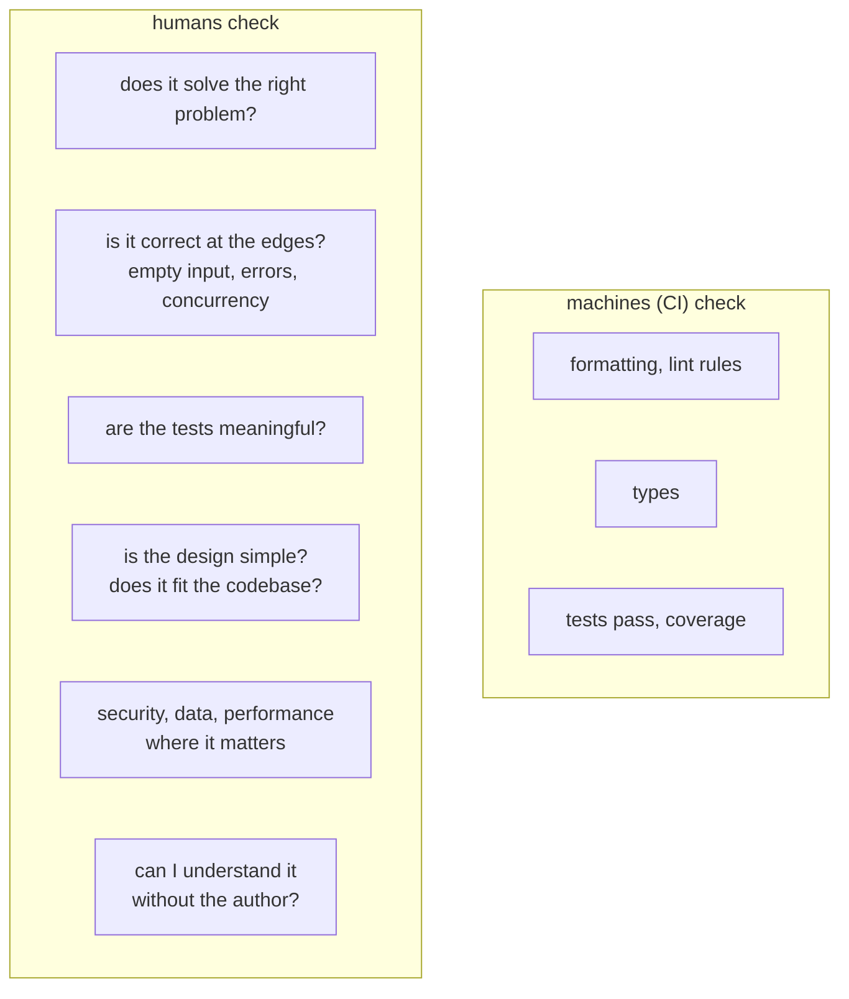

# Lesson 13 · Code review and documentation

> **Level:** ⚫ Professional · **Time:** ~2.5 h · **Assignment:** [13 · Review fixes](assignments/13-review-fixes/)

Code is read far more often than it is written: by reviewers today, by colleagues next month, by you in a
year. Two habits decide whether that reading is fast or painful: **documentation** that answers the
reader's questions where they have them, and **code review** that catches problems while they are still
cheap and spreads knowledge through the team. Neither needs special tools. Both need practice. This
lesson collects what works.

## What you will learn

- what to document where: names, type hints, docstrings, comments, README, decision records
- docstring conventions (PEP 257, Google style) and doctests that keep examples honest
- deprecating an API without breaking its users
- what a reviewer looks for, and a checklist to do it systematically
- giving feedback that helps, and receiving it without friction
- preparing a pull request that is easy to review

---

## 1. Documentation in layers

Different readers ask different questions. Answer each in the place where they look:

| Question | Answered by | Example |
|---|---|---|
| what is this value? | a good **name** | `overdue_days`, not `d` |
| what goes in and out? | **type hints** | `def fine_cents(days: int) -> int` |
| how do I use this function? | a **docstring** with an example | `"""Return the fine in cents. ..."""` |
| why is this line so odd? | a **comment** | `# the API counts from 1, not 0` |
| what is this project, how do I run it? | the **README** | install, usage, development setup |
| what changed in 2.0? | the **changelog** (lesson 12) | `### ⚠ Breaking changes` |
| why did we choose SQLite over PostgreSQL? | a **decision record** | `docs/adr/0003-sqlite.md` |

**Comments explain why, not what.** `i += 1  # increment i` adds nothing. `# retry once: the first call
after a cold start often times out` saves the next reader an hour. If a comment is needed to explain
**what** the code does, try a better name or a smaller function first.

## 2. Docstrings

A **docstring** is the first string literal in a module, class or function. It becomes `__doc__`, shows up
in `help()`, in editors on hover, and in generated documentation (Sphinx, MkDocs with mkdocstrings).
PEP 257 sets the basics: a one-line summary in the imperative, a blank line, then details. A common
format for the details is **Google style**:

```python
def parse_amount(text: str) -> int:
    """Parse a money amount like "12.50" or "12,50" into cents.

    Args:
        text: The amount with at most two decimals; a comma or a dot as separator.

    Returns:
        The amount in cents.

    Raises:
        ValueError: If the text is not a non-negative amount.

    >>> parse_amount("12,50")
    1250
    """
```

Document what the caller needs: purpose, arguments that are not obvious, return value, exceptions,
side effects. Do not repeat the type hints in words, and do not describe the implementation: it changes,
and the docstring would lie.

## 3. Doctests: examples that are tested

An example in a docstring is the most useful documentation there is, and the first to go wrong when the
code changes. **Doctest** runs it: every line starting with `>>> ` is executed, and the output must match
the next lines exactly.

```text
$ python -m doctest invoice.py -v
Trying:
    parse_amount("12,50")
Expecting:
    1250
ok
...
5 passed and 0 failed.
Test passed.
```

pytest runs them too with `pytest --doctest-modules`. Exceptions are written like this, and only the
last line has to match:

```python
>>> parse_amount("twelve")
Traceback (most recent call last):
ValueError: not an amount: 'twelve'
```

Keep doctests short and illustrative; put edge cases and many variations in real tests.

## 4. Deprecating an API

You want to rename `calc()` to `total()`. Deleting `calc` breaks every caller at once. Professional
libraries **deprecate** first: the old name keeps working for a while, but warns.

```python
import warnings

def calc(lines):
    """Deprecated: use total()."""
    warnings.warn("calc() is deprecated, use total()", DeprecationWarning, stacklevel=2)
    return total(lines)
```

`stacklevel=2` makes the warning point at the **caller's** line (the code that has to change), not at
`calc` itself. `DeprecationWarning`s are hidden by default in normal programs, but shown in tests and
when running with `python -W default`. Note the deprecation in the changelog, remove the old name in the
next **major** version (lesson 12). Python 3.13 adds the decorator `warnings.deprecated`.

## 5. Code review: what to look for

Review is not about finding someone to blame. Its goals: catch defects early, keep the code consistent,
and **share knowledge**: after the review, two people understand the change. The formatter, linter, type
checker and tests (lessons 02, 03, 12) already handle the mechanical parts, so humans can focus on what
machines cannot see.



A checklist keeps reviews consistent:

| Area | Questions |
|---|---|
| **purpose** | Does the description say what and why? Does the change do that, and only that? |
| **correctness** | Edge cases: empty, zero, negative, huge, `None`, unicode, duplicates? Errors handled or deliberately propagated? |
| **tests** | Would they fail if the code were wrong (lesson 03)? Do they cover the edges just listed? |
| **design** | Simplest thing that works? Duplicates something that exists? Right layer (lesson 10)? |
| **readability** | Names, function size, comments that explain why? |
| **safety** | Input validation, injection, secrets in logs (lessons 04, 11)? |
| **operations** | Logging, configuration, migrations, backwards compatibility? |

Typical findings are the classics from the whole course: a mutable default argument, `float` for money,
a bare `except` that hides errors, an accidental O(n²) loop, a missing edge case, an API renamed without
deprecation, a function without a docstring. The assignment has all of them.

## 6. Giving and receiving feedback

| Do | Instead of |
|---|---|
| comment on the code: "this loop is O(n²) for large invoices" | the person: "you always write slow code" |
| be specific and suggest: "a `Counter` would make this one pass" | "this is bad" |
| ask when unsure: "what happens if `lines` is empty here?" | assuming it is wrong |
| label the weight: **blocking**, **suggestion**, **nit**, **question** | leaving the author to guess what must change |
| praise good solutions | only ever listing problems |
| review promptly (within a day) | letting pull requests rot |

As the **author**: keep pull requests small (a few hundred lines at most), write a description (what,
why, how to test, screenshots for UI), **review your own diff first**, and answer every comment, with a
change or a reason. Disagreements about style go into the linter configuration, not into endless threads.

```markdown
## What
Store prices as integer cents instead of floats.

## Why
0.1 + 0.2 != 0.3: totals were off by one cent on ~2 % of invoices (#311).

## How to test
`pytest tests/test_invoice.py`; the new cases cover rounding at x.5 cents.
```

## 7. READMEs and decision records

A good **README** answers, in this order: what is it (one paragraph), how do I install and use it (a
copy-pasteable example), how do I develop on it (set up, run tests, conventions), and where to get help.
This repository's main README is an example.

An **architecture decision record** (ADR) is a short file per important decision: context, decision,
consequences. In a year, when someone asks "why on earth SQLite?", the answer is in `docs/adr/`, with the
reasons that were true at the time.

---

## Common mistakes

**Docstrings that repeat the code.** `"""Loops over lines and adds the prices."""` Say what it returns and why it exists.

**Out-of-date examples.** Run them as doctests.

**Comments instead of better names.** `x = d * 25  # fine in cents` → `fine_cents = overdue_days * 25`.

**Removing or renaming public functions without warning.** Deprecate, document, remove in a major version.

**Nit-picking style in reviews.** Automate it. Spend review attention on correctness and design.

**2 000-line pull requests.** Reviewers skim and approve. Split them.

**Taking review comments personally** (or writing comments that invite it). It is about the code.

## Try it yourself

1. Run `help(str.split)` and `help(json.dumps)`. How are those docstrings structured?
2. Add a doctest to one of your solutions and run `python -m doctest -v file.py`.
3. Write a function that warns with `DeprecationWarning` and call it once with `stacklevel=1` and once with `stacklevel=2`, using `python -W default`. Which line does each warning point to?
4. Take your solution to an earlier assignment and review it with the checklist from section 5. Write down three comments.
5. Write a three-section ADR for one decision you made in a capstone.

## Summary

- Document in layers: names, type hints, docstrings, why-comments, README, changelog, decision records.
- Docstrings: an imperative summary, then what the caller needs (args, returns, raises), plus an example.
- Doctests keep examples true; run them with `python -m doctest` or `pytest --doctest-modules`.
- Deprecate before removing: `warnings.warn(..., DeprecationWarning, stacklevel=2)`, remove in a major version.
- Review for purpose, correctness, tests, design, readability and safety; let machines check style.
- Feedback: about the code, specific, labelled, kind and prompt. Pull requests: small, described, self-reviewed.

## Assignment

➡️ **[13 · Review fixes](assignments/13-review-fixes/)**: a pull request came back with seven review comments. Address every one: mutable defaults, float money, a bare except, an O(n²) loop, a weekend bug, a deprecation, and doctested docstrings.

---

<p align="center">
  <a href="../12-git-ci-and-releases/">← Previous: 12 · Git, CI and releases</a> · <a href="../README.md">Professional overview</a> · <a href="../capstone-link-shortener/">Next: 🏁 Capstone: link shortener →</a>
</p>
