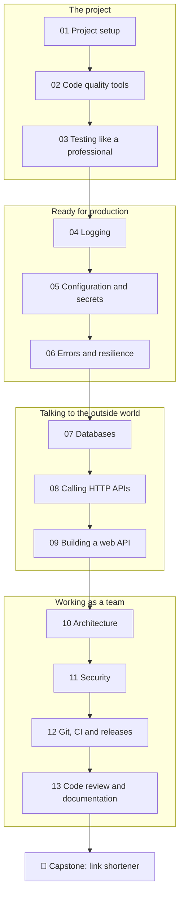

# ⚫ Professional level

**Goal:** after this level you write Python the way a professional team does. You set up projects that
others can install and work on, keep the code clean with linters and type checkers, test it so well that
a bug cannot sneak in, and give it what production needs: logging, configuration, error handling, a
database, HTTP on both sides, a clean architecture and basic security. You finish with the habits around
the code: Git, CI, releases, documentation and code review.

**Time:** about 45–55 hours, spread over a few weeks.

**You need:** the [Advanced level](../advanced/) (or equivalent knowledge: decorators, context managers,
the data model, protocols and generics, packaging) and the setup from the [main README](../README.md#set-up-python-a-venv-and-pytest).

## The lessons

| # | Lesson | You will learn | Assignment |
|---|---|---|---|
| 01 | [Project setup](01-project-setup/) | the project layout, virtual environments, dependencies, version specifiers, lock files, `uv` | 01 |
| 02 | [Code quality tools](02-code-quality-tools/) | formatters, linters, type checkers, `pre-commit`, and how a linter reads your code with `ast` | 02 |
| 03 | [Testing like a professional](03-testing-like-a-professional/) | fixtures, parametrize, test doubles, `unittest.mock`, coverage, and testing your tests | 03 |
| 04 | [Logging](04-logging/) | loggers, handlers, formatters, levels, `dictConfig`, structured logs, context with `contextvars` | 04 |
| 05 | [Configuration and secrets](05-configuration-and-secrets/) | the twelve-factor rule, environment variables, `.env` files, layered settings, validation, keeping secrets secret | 05 |
| 06 | [Errors and resilience](06-errors-and-resilience/) | exception design, chaining, retries with backoff and jitter, timeouts, circuit breakers, idempotency | 06 |
| 07 | [Databases](07-databases/) | SQL with `sqlite3`, parameters and injection, transactions, migrations, the repository pattern, ORMs | 07 |
| 08 | [Calling HTTP APIs](08-calling-http-apis/) | HTTP from the ground up, `urllib`, JSON APIs, timeouts, pagination, rate limits, testable clients | 08 |
| 09 | [Building a web API](09-building-a-web-api/) | WSGI, routing, request and response, status codes, validation, middleware, frameworks | 09 |
| 10 | [Architecture](10-architecture/) | layers, dependency injection, ports and adapters, a functional core in an imperative shell | 10 |
| 11 | [Security](11-security/) | injection, path traversal, password hashing, signed tokens, `secrets`, `hmac`, safe dependencies | 11 |
| 12 | [Git, CI and releases](12-git-ci-and-releases/) | branches and pull requests, commit messages, GitHub Actions, semantic versions, changelogs | 12 |
| 13 | [Code review and documentation](13-code-review-and-documentation/) | docstrings, doctests, READMEs, decision records, reviewing and being reviewed | 13 |
| 🏁 | [Capstone: link shortener](capstone-link-shortener/) | everything above, in one tested web service with a database, an API, logging and a command line | capstone |



## How each lesson is built

The same structure as in the levels before:

1. **What you will learn**: the goals, in one list.
2. **The theory**: how the tool or practice works, with diagrams and short runnable examples.
   The output of each example is shown in a comment (`# → ...`).
3. **Common mistakes**: the errors almost every team makes once, and how to recognise them.
4. **Try it yourself**: a few quick experiments.
5. **Summary**: the few lines worth remembering.
6. **Assignment**: the graded exercise for this lesson.

The Professional level is about **code that other people depend on**: colleagues who read it, servers
that run it at 3 a.m., users who trust it with their data. The lessons name the popular third-party
tools (ruff, pytest-cov, requests, FastAPI, SQLAlchemy, …) and explain when to use them, but every
assignment runs on the **standard library** alone. You build a small version of the tool yourself, so you
understand what the real one does for you.

## How to check your work

From the repository root, with your venv active:

```bash
pytest professional/01-project-setup/assignments/01-requirement-checker
```

Every task folder has the same three files: `README.md` (the task), `exercise.py` (your file) and
`test_exercise.py` (the tests). The template solutions are in [`solutions/professional/`](../solutions/professional/).
