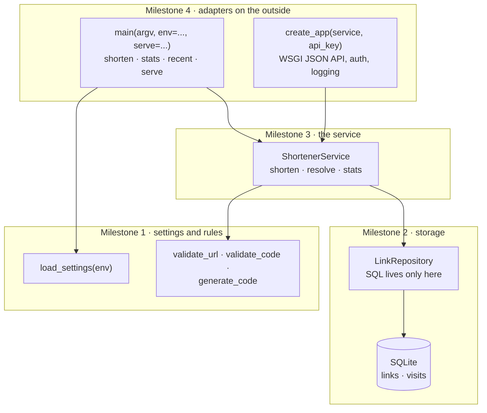
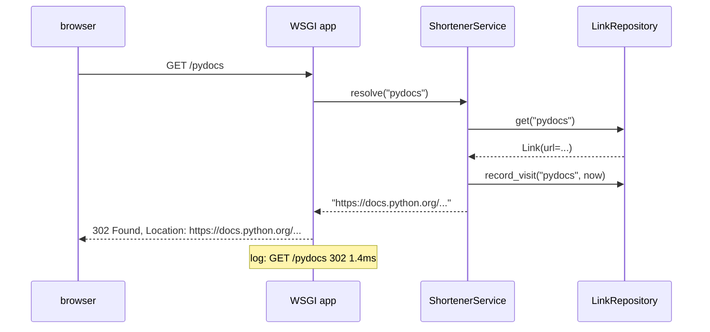

# 🏁 Capstone · Link shortener

> **Level:** ⚫ Professional · **Difficulty:** ⭐⭐⭐⭐⭐ · **Time:** ~10–12 h, spread over several sessions

You made it through all thirteen Professional lessons. Now build a small but real **web service**: a link
shortener like bit.ly. It turns `https://docs.python.org/3/library/sqlite3.html` into
`https://sho.rt/pydocs`, redirects visitors, and counts the clicks. It has everything a production
service needs, in miniature: validated configuration, a database with migrations, a clean service layer,
a JSON API with authentication and proper status codes, request logging, a command line, and tests at
every layer.

```text
$ export SHORT_API_KEY=dev SHORT_DATABASE=links.db
$ python exercise.py shorten https://docs.python.org/3/library/sqlite3.html --code pydocs
http://localhost:8000/pydocs

$ python exercise.py serve
serving on http://127.0.0.1:8000  (Ctrl+C to stop)
```

```text
$ curl -i http://127.0.0.1:8000/pydocs
HTTP/1.0 302 Found
Location: https://docs.python.org/3/library/sqlite3.html

$ curl -X POST http://127.0.0.1:8000/links -H "X-API-Key: dev" -d '{"url": "https://www.python.org"}'
{"code": "Xk3pQz", "url": "https://www.python.org", "short_url": "http://localhost:8000/Xk3pQz"}

$ curl http://127.0.0.1:8000/links/pydocs/stats -H "X-API-Key: dev"
{"code": "pydocs", "url": "https://docs.python.org/...", "clicks": 1, "last_visit": "2026-11-01T09:31:12+00:00", ...}
```

## How the program is built

The four layers of lesson 10, one milestone each. Dependencies point inwards: the rules know nothing
about SQLite or HTTP, and the service talks to a repository and a clock that are passed in.



What happens when someone opens a short link:



## What you use from each lesson

| Lesson | Where it shows up |
|---|---|
| 01 Project setup · 02 Code quality | a typed, linted single module; the template solution passes `mypy --strict`; stretch goal: a real project with `pyproject.toml` |
| 03 Testing | 71 tests over four milestones, fakes for the clock and the code generator, an in-memory database |
| 04 Logging | one log line per request; unexpected errors logged with their traceback |
| 05 Configuration and secrets | `SHORT_*` environment variables, validated at startup, all errors at once; the API key never in `repr` |
| 06 Errors and resilience | one exception hierarchy, translated to HTTP statuses at the boundary; retries on code collisions |
| 07 Databases | migrations with `user_version`, a repository, `JOIN` + `GROUP BY`, a foreign key, `IntegrityError` → `CodeTaken` |
| 08 · 09 HTTP | a WSGI JSON API with `201`, `302`, `400`, `401`, `404`, `405`, `409`, `422`, `500`, tested directly and over a real socket |
| 10 Architecture | settings, rules, repository, service and adapters as separate layers; dependencies injected |
| 11 Security | URL validation, `secrets` for codes, `hmac.compare_digest` for the API key, parameterised SQL |
| 12 · 13 Releases and review | stretch goals: CI, a changelog, a deprecation; a review of your own code with the checklist |

## Milestones

Work through them in order. Each has its own tests:

```bash
pytest professional/capstone-link-shortener -v -k milestone1
```

Given in `exercise.py`: the exceptions (`ShortenerError` with `InvalidInput`, `NotFound`, `CodeTaken`, and
`ConfigError`), the `Settings` and `Link` dataclasses, `MIGRATIONS`, the constants, `utc_now`,
`build_parser` and `_wsgiref_serve`.

### Milestone 1 · Settings and rules

| Name | Specification |
|---|---|
| `load_settings(env)` | builds `Settings` from a mapping: `SHORT_API_KEY` (**required**, not empty), `SHORT_DATABASE`, `SHORT_BASE_URL` (an `http`/`https` URL with a host; a trailing `/` is removed), `SHORT_CODE_LENGTH` (a number from 4 to 32). Other keys are ignored. Collect **all** errors, in this order, and raise `ConfigError(errors)`: `"SHORT_API_KEY: missing"`, `"SHORT_BASE_URL: expected an http(s) URL, got '<value>'"`, `"SHORT_CODE_LENGTH: expected a number from 4 to 32, got '<value>'"` |
| `validate_url(url)` | strips whitespace and returns the URL with scheme and host in lower case (path, query and fragment unchanged). `InvalidInput` for: empty, longer than `MAX_URL_LENGTH`, containing whitespace, a scheme other than `http`/`https`, no host, or an invalid port |
| `validate_code(code)` | returns a valid custom code: 3 to 32 characters from `A-Z a-z 0-9 _ -` (ASCII only), and not one of `RESERVED_CODES` in any case. Otherwise `InvalidInput` |
| `generate_code(length, choice=secrets.choice)` | `length` characters, each `choice(ALPHABET)`. The default **must** be `secrets.choice`: guessable codes leak private links |

### Milestone 2 · Storage

| Name | Specification |
|---|---|
| `connect(path=":memory:")` | opens the database with `check_same_thread=False` (the web server may call from another thread), turns on foreign keys, and applies the `MIGRATIONS` above `PRAGMA user_version`, each in its own transaction (lesson 07) |
| `LinkRepository(conn)` | all SQL lives here; always with placeholders |
| `.add(code, url, created_at)` | inserts and commits; returns `Link(code, url, created_at, 0)`. An existing code raises `CodeTaken` **chained** to the `IntegrityError` |
| `.get(code)` | the `Link` with `clicks` = its number of visits, or `None` |
| `.record_visit(code, at)` | stores a visit (the foreign key rejects unknown codes) |
| `.last_visit(code)` | the latest `visited_at`, or `None` |
| `.recent(limit=10)` | the newest links first (by `created_at`, then code), with their clicks |

### Milestone 3 · The service

`ShortenerService(repo, *, base_url, code_length=6, clock=utc_now, make_code=generate_code)`. Times are
stored as `clock().isoformat(timespec="seconds")`, for example `"2026-11-01T09:30:00+00:00"`.

| Method | Specification |
|---|---|
| `short_url(code)` | `base_url` without a trailing `/`, plus `/` and the code |
| `shorten(url, code=None)` | validates the URL (before touching the database). With a `code`: validate it and store the link (a taken code raises `CodeTaken`). Without: `make_code(code_length)`, and on `CodeTaken` try a new code, **five attempts** in total, then raise `ShortenerError("could not find a free code")`. Returns the `Link` |
| `resolve(code)` | records a visit (at `clock()`) and returns the URL; `NotFound` for an unknown code |
| `stats(code)` | `{"code", "url", "short_url", "created_at", "clicks", "last_visit"}`; does **not** count as a visit; `NotFound` for an unknown code |

### Milestone 4 · The web API and the command line

`create_app(service, api_key)` returns a WSGI application. Every response has a `Content-Length` and a
status line with the phrase from `HTTPStatus`; JSON responses have `Content-Type: application/json;
charset=utf-8`. Errors are `{"error": "<message>"}`.

| Request | Response |
|---|---|
| `GET /health` | `200 {"status": "ok"}` |
| `POST /links` with `{"url": ..., "code": optional}` | needs the header `X-API-Key` equal to `api_key`, compared with `hmac.compare_digest`, else `401`. Invalid JSON → `400`. Not an object, or `url` not a string, or `code` present but not a string → `422`. Then `service.shorten`: `201 {"code", "url", "short_url"}` with a `Location` header |
| any other method on `/links` | `405`, header `Allow: POST` |
| `GET /links/<code>/stats` | needs the API key (`401`); `200` with `service.stats(code)` |
| `GET` or `HEAD /<code>` | `302 Found`, `Location: <url>`, empty body |
| anything else | `404` |

Exceptions from the service map to statuses at this boundary: `InvalidInput` → `422`, `NotFound` →
`404`, `CodeTaken` → `409`, anything unexpected → `500 {"error": "internal server error"}` plus
`log.exception(...)`. After every request, log one INFO line on the `shortener` logger:
`"<METHOD> <path> <status> <ms>ms"`, for example `GET /pydocs 302 1.4ms`.

`main(argv=None, *, env=None, serve=_wsgiref_serve)` (`env` defaults to `os.environ`) parses `argv` with
`build_parser()`, loads the settings, connects to the database, builds the service, and runs one command:

| Command | Prints | Exit code |
|---|---|---|
| `shorten URL [--code CODE]` | the short URL | 0 |
| `stats CODE` | one line per stats field, `key:` then the value (`-` for `None`) | 0 |
| `recent` | one line per recent link: code, clicks, URL | 0 |
| `serve [--host H] [--port P]` | calls `serve(app, host, port)` with `create_app(service, settings.api_key)` | 0 |
| a `ShortenerError` | `shortener: error: <message>` to **stderr** | 1 |
| a `ConfigError` | `shortener: <the error>` to **stderr** | 2 |

Close the database connection before returning.

## Hints

<details>
<summary>Milestone 1: URLs</summary>

`urllib.parse.urlsplit(url)` gives `scheme`, `netloc`, `hostname`, `path`, `query`, `fragment`; reading
`.port` raises `ValueError` for an invalid port. `urlunsplit` puts the parts back together.
</details>

<details>
<summary>Milestone 2: clicks in one query</summary>

`SELECT links.code, links.url, links.created_at, COUNT(visits.id) FROM links LEFT JOIN visits ON
visits.code = links.code WHERE links.code = ? GROUP BY links.code`: the `LEFT JOIN` keeps links without
visits, `COUNT(visits.id)` counts only real visits. `Link(*row)` builds the dataclass.
</details>

<details>
<summary>Milestone 4: the app</summary>

Split it in two: an inner `route(environ)` that returns `(status, headers, body)` or raises, and the WSGI
function `app(environ, start_response)` that calls it, turns every exception into a response with one
`try` / `except` chain, logs the line, and calls `start_response` exactly once. Two regular expressions,
`/links/([A-Za-z0-9_-]+)/stats` and `/([A-Za-z0-9_-]+)`, are all the routing you need.
</details>

## Try it for real

```bash
SHORT_API_KEY=dev SHORT_DATABASE=links.db python professional/capstone-link-shortener/exercise.py serve
```

Then, in a second terminal, use the `curl` commands from the top of this page, or open a short link in
the browser.

## Check your work

```bash
pytest professional/capstone-link-shortener -v
```

## Stretch goals

Done and all green? These have no tests; they are for practice.

- **A real project** (lessons 01, 02, 12): move the code into `src/shortener/` with one module per layer,
  a `pyproject.toml` with a `shortener` command, ruff and mypy settings, and a GitHub Actions workflow
  that runs lint, types and tests on every push.
- **JSON logs with request ids** (lesson 04): use your `JsonFormatter` and request-id middleware from
  assignments 04 and 09.
- **Rate limiting** (lessons 06, 08): at most 10 `POST /links` per API key per minute, answered with `429`
  and a `Retry-After` header.
- **Expiring links**: an optional `expires_in` (seconds) when creating; expired links answer `410 Gone`.
  Add it as migration 3.
- **A client** (lesson 08): an `ApiClient`-based Python client for your own API, tested against the
  running server.
- **Review** (lesson 13): go through your solution with the review checklist, write three comments, and
  fix them. Add doctests to the rules of milestone 1.

## Done?

Compare with the [template solution](../../solutions/professional/capstone-link-shortener/exercise.py). Read it as
a whole: notice that the SQL lives in one class, that no function below milestone 4 knows about HTTP,
that every dependency is passed in, and that the API key never appears in a log or a `repr`.

Then tick off the capstone in the [progress checklist](../../README.md#progress-checklist).
**Congratulations: you have finished the Professional level, and with it the whole learning path. 🎉**

---

<p align="center">
  <a href="../13-code-review-and-documentation/">← Previous: 13 · Code review and documentation</a> · <a href="../README.md">Professional overview</a>
</p>
